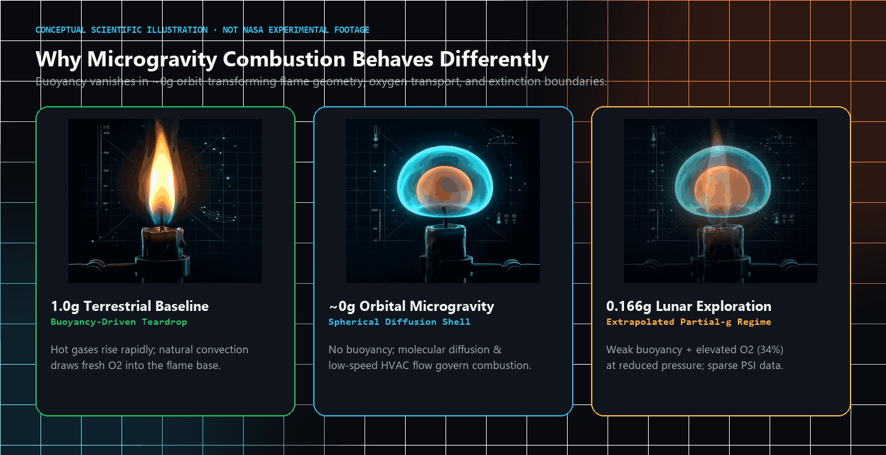
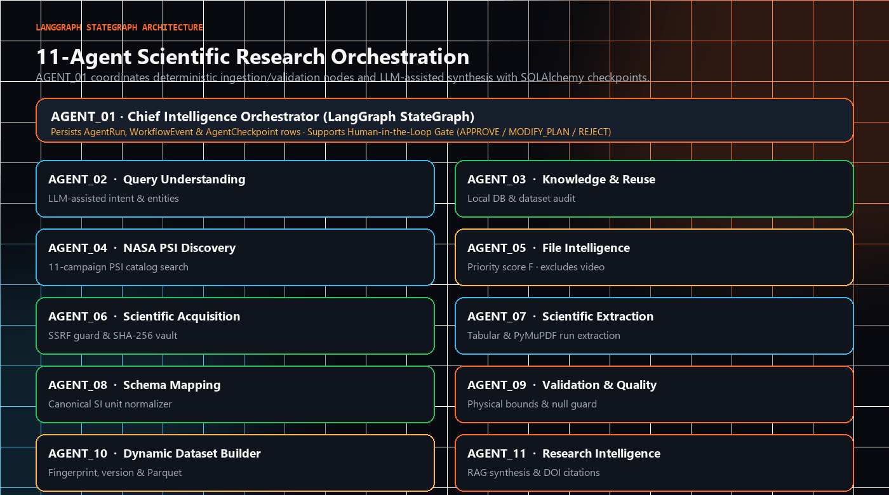
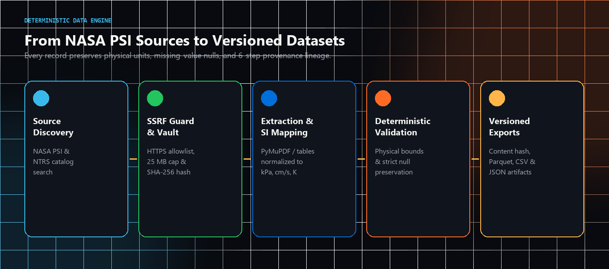
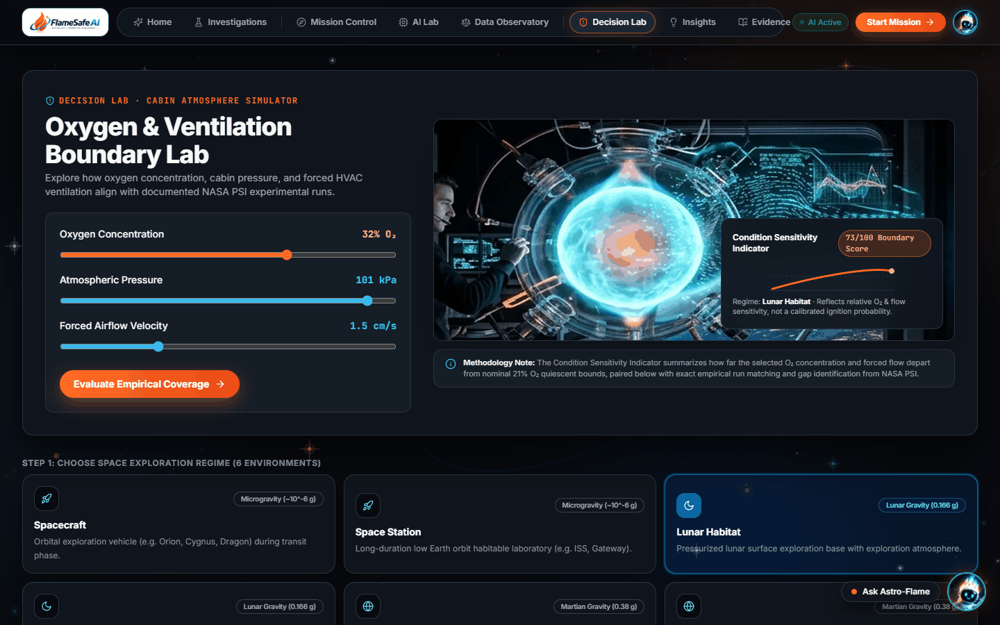
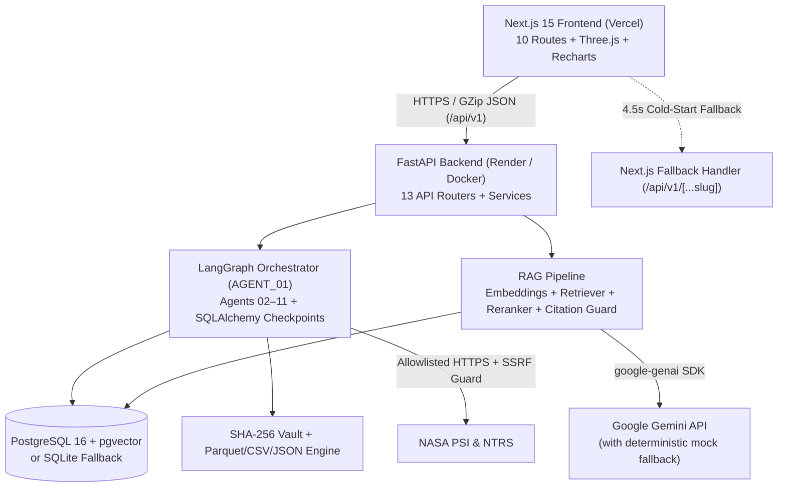

<div align="center">


# FlameSafe AI

### **MICROGRAVITY COMBUSTION INTELLIGENCE**

**Understanding Fire Beyond Earth.**

An AI-powered scientific intelligence platform transforming NASA microgravity combustion research and experimental data into structured, searchable, comparable, and explainable scientific knowledge for safer space exploration.

<p>
  <a href="#about-flamesafe-ai">Overview</a> &bull;
  <a href="#platform-capabilities">Capabilities</a> &bull;
  <a href="#nasa-psi-research">NASA PSI Data</a> &bull;
  <a href="#multi-agent-ai-system">11-Agent AI</a> &bull;
  <a href="#scientific-data-engine">Data Engine</a> &bull;
  <a href="#rag-and-evidence-intelligence">RAG &amp; Evidence</a> &bull;
  <a href="#technical-architecture">Architecture</a> &bull;
  <a href="#local-installation">Quick Start</a> &bull;
  <a href="docs/README.md">Full Docs</a>
</p>

[](frontend/package.json)
[](frontend/tsconfig.json)
[](backend/app/main.py)
[](backend/requirements.txt)
[](backend/app/agents/orchestrator/supervisor.py)
[](docker-compose.yml)
[](Dockerfile)
[](LICENSE)

<br />


</div>

> [!NOTE]
> **Project Context & Independence:** Developed by **Team R²** for the **NASA Space Apps Challenge 2026**. FlameSafe AI is an independent open-source scientific research platform that organizes publicly available **NASA Physical Sciences Informatics (PSI)** and **NASA Technical Reports Server (NTRS)** resources. No official NASA sponsorship, endorsement, certification, or partnership is implied.

---

## Table of Contents

1. [About FlameSafe AI](#about-flamesafe-ai)
2. [Why Microgravity Combustion Matters](#why-microgravity-combustion-matters)
3. [Explore the Platform](#explore-the-platform)
4. [Platform Capabilities](#platform-capabilities)
5. [NASA PSI Research](#nasa-psi-research)
6. [Multi-Agent AI System](#multi-agent-ai-system)
7. [Scientific Data Engine](#scientific-data-engine)
8. [RAG and Evidence Intelligence](#rag-and-evidence-intelligence)
9. [Research Analysis and Decision Support](#research-analysis-and-decision-support)
10. [Earth Applications and Research Gaps](#earth-applications-and-research-gaps)
11. [Technical Architecture](#technical-architecture)
12. [Technology Stack](#technology-stack)
13. [Project Structure](#project-structure)
14. [Local Installation](#local-installation)
15. [Configuration](#configuration)
16. [API Documentation](#api-documentation)
17. [Testing](#testing)
18. [Deployment](#deployment)
19. [Scientific Integrity](#scientific-integrity)
20. [Team and Credits](#team-and-credits)
21. [License](#license)

---

## About FlameSafe AI

Spacecraft and extraterrestrial habitats face unique fire hazards. Decades of orbital combustion experiments aboard the **International Space Station (ISS)** and **Cygnus** cargo vehicles are published across **NASA Physical Sciences Informatics (PSI)** and **NTRS**, yet critical engineering parameters—limiting oxygen concentrations, ambient pressures, forced ventilation velocities, flame spread rates, and aerosol distributions—are scattered across PDFs, spreadsheets, and incompatible unit systems.

**FlameSafe AI** bridges this gap by unifying:
- **Structured Scientific Catalog & SI Normalization:** Standardizes pressure (`kPa`), airflow (`cm/s`), oxygen (`% O2`), and flame spread rate while preserving unrecorded values as `null` (`Not recorded`).
- **11-Agent LangGraph Research Orchestrator:** Automates query decomposition, NASA PSI discovery, priority file scoring, SSRF-guarded acquisition, deterministic validation, and versioned Parquet/CSV/JSON dataset construction.
- **Citation-Verified RAG & Decision Support:** Grounds scientific Q&A in DOI-linked `EvidenceChunk` records, compares `1.0g` vs. `~0g` vs. extrapolated `0.166g` regimes, and explicitly abstains when empirical evidence is absent.

**Who It Serves:** Aerospace fire-safety engineers, Environmental Control and Life Support System (ECLSS) architects, microgravity combustion researchers, and technical reviewers.

---

## Why Microgravity Combustion Matters



*Conceptual scientific visualization comparing gravitational combustion regimes (not NASA experimental footage).*

| Gravitational Regime | Governing Physics | Spacecraft Fire Safety Implication | Empirical Coverage in NASA PSI |
| :--- | :--- | :--- | :--- |
| **`1.0g` Terrestrial Baseline** | Buoyancy-driven upward convection draws fresh oxidizer into the flame base | Standard terrestrial flammability tests (`NASA-STD-6001`) can mispredict orbital behavior | Extensive ground baseline |
| **`~0g` Orbital Microgravity** | Buoyancy vanishes; molecular diffusion and low-speed HVAC flow (`1–20 cm/s`) dominate | Solid polymers burn at lower `% O2` in low-speed flow; smoke aerosols form larger aggregates; cool flames (`~650 K`) can persist | Direct ISS & Cygnus flight campaigns (`BASS`, `SAFFIRE`, `FLEX`, `SAME`, `ACME`) |
| **`0.166g` Lunar / `0.38g` Mars** | Weak partial buoyancy combined with elevated-O2 (`~34% O2`), reduced-pressure (`~56.5 kPa`) cabins | Potential accelerated concurrent flame spread with sparse direct flight validation | **Extrapolated Regime / Research Gap** |

---

## Explore the Platform

FlameSafe AI opens with an orbital mission experience featuring an interactive **Three.js** 3D hero scene, live repository telemetry counters, and direct navigation across 10 specialized App Router routes.


---

## Platform Capabilities

Every capability below is verified against the actual frontend routes (`frontend/app/`) and backend routers (`backend/app/api/v1/endpoints/`).

| Capability | Route & Docs | What It Does | Primary Backend / Service | Status |
| :--- | :--- | :--- | :--- | :--- |
| **Mission Control** | [`/dashboard`](docs/features/mission-control.md) | Live repository KPIs, research domain charts, fuel breakdown, and workflow telemetry | `GET /api/v1/overview` | `IMPLEMENTED AND TESTED` |
| **NASA PSI Explorer** | [`/investigations`](docs/features/investigations.md) | Multi-facet filtering, run conditions, SI measurements, and DOI-linked documents | `GET /api/v1/investigations` | `IMPLEMENTED AND TESTED` |
| **AI Research Lab** | [`/research`](docs/features/ai-lab.md) | 11-agent LangGraph execution, HITL approval gates, checkpoint recovery, live AI probe | `/api/v1/research/requests/*` | `IMPLEMENTED AND TESTED` |
| **Dynamic Dataset Engine** | [`/research`](docs/features/ai-lab.md) | Content fingerprinting, semantic versioning, 6-step lineage, Pandas analytics, Parquet/CSV/JSON | `/api/v1/datasets/*` | `IMPLEMENTED AND TESTED` |
| **Data Observatory** | [`/compare`](docs/features/data-observatory.md) | Side-by-side matrix (2–4 campaigns), radar coverage, 1g/0g/0.16g comparison, CSV/JSON export | `POST /api/v1/compare` | `IMPLEMENTED AND TESTED` |
| **Decision Lab & Gaps** | [`/scenarios`](docs/features/decision-lab.md) | Evaluates target O2, pressure, flow, and gravity against empirical PSI runs | `POST /api/v1/scenarios/analyze` | `IMPLEMENTED AND TESTED` |
| **Research Insights** | [`/insights`](docs/features/insights.md) | Multi-factor `RelevanceScorer` ranking across fire safety decision modes | `POST /api/v1/rank` | `IMPLEMENTED AND TESTED` |
| **Evidence & Citation Vault** | [`/evidence`](docs/features/evidence.md) | Searchable primary NASA PSI / NTRS literature, DOIs, page excerpts, JSON export | `GET /api/v1/sources` | `IMPLEMENTED AND TESTED` |
| **Astro-Flame Companion** | [`/assistant`](docs/features/astro-flame.md) | Dedicated page & global floating RAG assistant with citation verification & abstention | `POST /api/v1/assistant/query` | `IMPLEMENTED AND TESTED` |
| **Earth Applications** | [`/`](frontend/app/page.tsx) | Highlights terrestrial clean-combustion & aerosol-detector spin-offs | Static / Seeded landing module | `IMPLEMENTED` |
| **Multi-Tenant Auth & RBAC** | — | User accounts, team workspaces, and role-based approval policies | — | `PLANNED` |

### Mission Control (`/dashboard`)


---

## NASA PSI Research

FlameSafe AI seeds and indexes **5 canonical NASA microgravity combustion flight programs** in its primary relational database (`AGENT_04` catalogs 11 campaigns for discovery):

| Acronym | Program Title | Facility & Platform | Fuel Systems | Stored DOI |
| :--- | :--- | :--- | :--- | :--- |
| **BASS** | Burning and Suppression of Solids (BASS & BASS-II) | Microgravity Science Glovebox (MSG) · ISS | PMMA, Cotton-Fiberglass (SIBAL), Nomex | [`10.1016/j.combustflame.2015.08.012`](https://doi.org/10.1016/j.combustflame.2015.08.012) |
| **SAFFIRE** | Spacecraft Fire Safety Demonstration (Saffire I–VI) | Cygnus Automated Transfer Vehicle | SIBAL Cloth (75/25), PMMA Ribbed Panel | [`10.1016/j.firesaf.2019.102874`](https://doi.org/10.1016/j.firesaf.2019.102874) |
| **FLEX** | Flame Extinguishment Experiment (FLEX & FLEX-2) | Combustion Integrated Rack (CIR / MDCA) · ISS | n-Heptane, Methanol, n-Decane | [`10.1016/j.combustflame.2014.01.019`](https://doi.org/10.1016/j.combustflame.2014.01.019) |
| **SAME** | Smoke Aerosol Measurement Experiment (SAME / SAME-R) | Microgravity Science Glovebox (MSG) · ISS | Kapton, Silicone, PTFE, Cellulose | [`10.4271/2009-01-2481`](https://doi.org/10.4271/2009-01-2481) |
| **ACME** | Advanced Combustion via Microgravity Experiments | Combustion Integrated Rack (CIR) · ISS | Methane, Ethylene, Coflow Gases | [`10.1016/j.proci.2020.06.154`](https://doi.org/10.1016/j.proci.2020.06.154) |

<table>
  <tr>
    <td width="50%">
      <strong>PSI Investigation Explorer (<code>/investigations</code>)</strong><br />
      
    </td>
    <td width="50%">
      <strong>Investigation Profile &amp; Runs (<code>/investigations/inv-bass-001</code>)</strong><br />
      
    </td>
  </tr>
</table>

---

## Multi-Agent AI System



**AGENT 01 (`ChiefIntelligenceOrchestrator`)** runs a compiled **LangGraph `StateGraph`** (`backend/app/agents/orchestrator/supervisor.py`). Rather than running 11 separate foundation models, `AGENT_01` coordinates 10 specialized workflow nodes (`AGENT_02`–`AGENT_11`): only `AGENT_02` and `AGENT_11` call the configured LLM (`gemini-3.8-flash` or deterministic mock fallback), while `AGENT_03`–`AGENT_10` execute deterministic discovery, security, extraction, SI mapping, bounds validation, and dataset construction logic.

```mermaid
flowchart LR
    S(["START"]) --> A02["AGENT_02<br/>Query Understanding"]
    A02 --> A03["AGENT_03<br/>Knowledge Reuse"]
    A03 --> A04["AGENT_04<br/>PSI Discovery"]
    A04 --> A05["AGENT_05<br/>File Selection"]
    A05 --> GATE{"HITL Gate?"}
    GATE -- "Approve / Auto" --> A06["AGENT_06<br/>Acquisition"]
    A06 --> A07["AGENT_07<br/>Extraction"]
    A07 --> A08["AGENT_08<br/>SI Schema Map"]
    A08 --> A09["AGENT_09<br/>Validation"]
    A09 --> A10["AGENT_10<br/>Dataset Builder"]
    A10 --> A11["AGENT_11<br/>RAG Synthesis"]
    A11 --> E(["READY"])
```



| Agent ID | Canonical Name (`supervisor.py`) | Primary Responsibility | Execution Type |
| :--- | :--- | :--- | :--- |
| `AGENT_01` | Chief Intelligence Orchestrator | LangGraph `StateGraph` routing, `AgentRun`, `WorkflowEvent`, `AgentCheckpoint` | Orchestration |
| `AGENT_02` | Query Understanding Agent | Decomposes question into fuel, gravity regime, and target variables | LLM-assisted / Fallback |
| `AGENT_03` | Existing Knowledge & Reuse Agent | Audits local DB and existing datasets for reusable records | Deterministic |
| `AGENT_04` | NASA PSI Discovery Agent | Searches and ranks 11 NASA PSI combustion campaigns | Deterministic |
| `AGENT_05` | File Intelligence & Selection Agent | Priority scoring (`F = 0.35Q + 0.25T + 0.20C + 0.10P + 0.10A`); excludes raw video | Deterministic |
| `AGENT_06` | Scientific Acquisition Agent | `PSISourceValidator` SSRF allowlist guard, 25 MB cap, and SHA-256 vaulting | Deterministic |
| `AGENT_07` | Scientific Extraction Agent | Extracts structured tabular and publication experimental run records | Deterministic |
| `AGENT_08` | Scientific Schema Mapping Agent | Maps records to canonical schema and SI units | Deterministic |
| `AGENT_09` | Validation & Quality Agent | Physical bounds checking and strict `null` preservation | Deterministic |
| `AGENT_10` | Dynamic Dataset Builder Agent | Content fingerprinting, semantic versioning, Parquet/CSV/JSON exports | Deterministic |
| `AGENT_11` | Research Intelligence Agent | RAG synthesis with DOI and document page citation verification | LLM-assisted / Fallback |

<table>
  <tr>
    <td width="50%">
      <strong>AI Research Intelligence Lab (<code>/research</code>)</strong><br />
      
    </td>
    <td width="50%">
      <strong>Workflow Controls &amp; Dataset Inspector (<code>/research</code>)</strong><br />
      
    </td>
  </tr>
</table>

<details>
<summary>Inspect Checkpointing, HITL Approval &amp; Audit Tables</summary>

- **Durable State Persistence:** Every node transition writes `AgentRun`, `WorkflowEvent`, and `AgentCheckpoint` rows to SQLAlchemy (`backend/app/models/multi_agent.py`), allowing interrupted workflows to resume from the last completed checkpoint (`POST /api/v1/research/requests/{id}/resume`) without re-downloading or re-extracting files.
- **Human-in-the-Loop Gate:** Setting `require_approval: true` pauses execution after `AGENT_05` file selection (`AWAITING_APPROVAL`) until a researcher submits `APPROVE`, `MODIFY_PLAN`, `REJECT`, or `RESUME_WORKFLOW` via `POST /api/v1/research/requests/{id}/approve`.

</details>

See [Multi-Agent Workflow Diagram](docs/architecture/multi-agent-workflow.md).

---

## Scientific Data Engine



- **SI Unit Normalization (`backend/app/ingestion/normalizers/unit_normalizer.py`):** Standardizes pressure (`kPa`), airflow (`cm/s`), oxygen concentration (`% O2`), and flame spread rate while recording the conversion formula.
- **Strict Null Preservation:** Unrecorded experimental measurements stay `null` (`Not recorded` in the UI)—never interpolated or coerced to zero.
- **Quality Scoring & 6-Step Lineage:** Computes dataset quality (`Q = 0.25*Completeness + 0.25*Provenance + 0.25*DOI + 0.25*SI_Consistency`) and traces every `DatasetItem` back through `ExperimentalRun` -> `Investigation` -> `ResearchDocument` DOI -> page/section -> NASA PSI.
- **Export & Pandas Workspace:** Exports real `Apache Parquet` (via `pyarrow`), `CSV`, and `JSON`, plus interactive grouping/filtering via `POST /api/v1/datasets/{id}/analytics`.


See [Scientific Data Lifecycle](docs/architecture/data-lifecycle.md).

---

## RAG and Evidence Intelligence


- **Dual-Mode Embeddings with Strict Isolation:** Supports `GeminiEmbeddingProvider` (`gemini-embedding-2`, `768` dimensions) and deterministic SHA-256 `MockEmbeddingProvider`. Each `EvidenceChunk` stores `embedding_provider` and `embedding_dimension` so vector spaces are never mixed.
- **Reranking, Citation Verification & Abstention:** Retrieves top-K chunks, reranks by relevance, verifies cited DOIs and investigation acronyms against retrieved records, and invokes an explicit abstention protocol when evidence falls below `SIMILARITY_THRESHOLD` (`0.65`).
- **Transparent Telemetry:** `GET /api/v1/ai/status` executes a live probe when `GEMINI_API_KEY` is configured and honestly reports `is_mock_provider: true` whenever the deterministic fallback is active.

<table>
  <tr>
    <td width="50%">
      <strong>Evidence &amp; Citation Vault (<code>/evidence</code>)</strong><br />
      
    </td>
    <td width="50%">
      <strong>Astro-Flame RAG Companion (<code>/assistant</code>)</strong><br />
      
    </td>
  </tr>
</table>


See [RAG Pipeline Architecture](docs/architecture/rag-pipeline.md).

---

## Research Analysis and Decision Support

<table>
  <tr>
    <td width="50%">
      <strong>Decision Lab &amp; Gap Intelligence (<code>/scenarios</code>)</strong><br />
      
    </td>
    <td width="50%">
      <strong>Scientific Relevance Insights (<code>/insights</code>)</strong><br />
      
    </td>
  </tr>
</table>

- **Decision Lab (`/scenarios`):** Maps target habitat conditions (oxygen %, pressure, forced airflow, gravity regime) against empirical NASA PSI runs, classifying each parameter as `Exact Match`, `Partial Match`, `Extrapolated Regime`, or `Unsupported Condition`.
  > [!IMPORTANT]
  > The *Condition Sensitivity Indicator* summarizes parameter departure from nominal `21% O2` quiescent bounds. It is a heuristic indicator—**not** a calibrated fire ignition probability.
- **Research Insights (`/insights`):** Implements `RelevanceScorer` (`backend/app/ranking/scoring.py`) using `R = w_d * D + w_f * F + w_c * C + w_m * M + w_q * Q` (Domain, Fuel, Conditions, Mission Applicability, Metadata Quality), reporting Measurement Completeness separately.

---

## Earth Applications and Research Gaps

- **Earth Applications (`IMPLEMENTED` on `/`):** Connects orbital findings—such as low-temperature cool-flame kinetics (`FLEX`) and larger microgravity smoke aerosol morphology (`SAME`)—to cleaner terrestrial combustion and improved fire-detection engineering.
- **Research Gap Intelligence (`IMPLEMENTED AND TESTED` on `/scenarios` & `/`):** Separates empirically verified ISS `~0g` flight regimes from under-tested **Lunar (`0.166g`)** and **Martian (`0.38g`)** exploration atmospheres.

---

## Technical Architecture



| Architecture Guide | Description |
| :--- | :--- |
| [System Architecture](docs/architecture/system-architecture.md) | End-to-end Next.js, FastAPI, LangGraph, RAG, and DB topology |
| [Multi-Agent Workflow](docs/architecture/multi-agent-workflow.md) | LangGraph `StateGraph` transitions and HITL checkpointing |
| [RAG Pipeline](docs/architecture/rag-pipeline.md) | Embeddings, vector/keyword retrieval, reranking, and citation verification |
| [Scientific Data Lifecycle](docs/architecture/data-lifecycle.md) | Source discovery, SHA-256 vault, SI normalization, and exports |
| [Database Schema & ERD](docs/architecture/database-schema.md) | SQLAlchemy ORM entities and Alembic migrations `001`–`004` |
| [Research Workflow](docs/architecture/research-workflow.md) | End-to-end researcher journey across platform modules |
| [Deployment Architecture](docs/architecture/deployment.md) | Vercel, Render, and Docker Compose environments |

---

## Technology Stack

| Layer | Verified Technologies | Role |
| :--- | :--- | :--- |
| **Frontend** | Next.js 15, React 19 RC, TypeScript 5.6, Tailwind CSS 3.4 | App Router UI, responsive aerospace design system, route error boundaries |
| **3D & Charts** | Three.js 0.187, Recharts 2.13, Lucide React | Interactive 3D orbital hero, radar/bar/pie scientific visualizations |
| **Backend API** | Python 3.11+, FastAPI, Uvicorn, Pydantic v2, `GZipMiddleware` | Async REST API (`/api/v1`), OpenAPI docs, standardized `APIResponseEnvelope` |
| **Database** | PostgreSQL 16 + `pgvector` (`asyncpg`), SQLAlchemy 2, Alembic, `aiosqlite` | Relational + 768-dim vector storage with automatic local SQLite fallback |
| **AI & Agents** | LangGraph `StateGraph`, `google-genai` (`gemini-3.8-flash`, `gemini-embedding-2`) | 11-agent workflow orchestration, semantic embeddings, and mock fallback |
| **Scientific Data** | Pandas, NumPy, PyArrow, PyMuPDF | PDF/table extraction, SI normalization, Apache Parquet exports, analytics |
| **DevOps & CI** | Docker, Docker Compose, GitHub Actions, Render, Vercel | Automated Ruff, Pytest, ESLint, TypeScript, unit tests, and builds |

---

## Project Structure

```text
FLAMESAFE-AI/
├── .github/workflows/ci.yml      # CI: Ruff, Pytest, Typecheck, Unit tests, Next.js build
├── backend/
│   ├── app/
│   │   ├── agents/               # LangGraph StateGraph (AGENT_01) & Nodes (AGENT_02–11)
│   │   ├── api/v1/endpoints/     # 13 FastAPI route modules (/api/v1/*)
│   │   ├── connectors/psi/       # NASA PSI catalog, file manifest, SSRF validator
│   │   ├── core/                 # Config, async DB + SQLite fallback, logging, exceptions
│   │   ├── datasets/             # Fingerprinting, versioning, quality, lineage, Parquet, Pandas
│   │   ├── ingestion/            # Extractors, SI unit normalizer, scientific validator
│   │   ├── models/               # SQLAlchemy ORM models (core + multi-agent)
│   │   ├── rag/                  # Chunker, Gemini/mock embeddings, retriever, reranker, citations
│   │   ├── ranking/              # Weighted RelevanceScorer & explainability
│   │   └── services/             # Comparison, investigation, ranking, scenario, AI services
│   ├── migrations/versions/      # Alembic migrations 001–004
│   ├── scripts/                  # Seed, migration, backfill, and live PSI smoke scripts
│   ├── Dockerfile
│   └── requirements.txt
├── frontend/
│   ├── app/                      # Next.js 15 App Router pages + /api/v1/[...slug] fallback
│   ├── components/               # Modular UI, charts, Three.js hero, Astro-Flame companion
│   ├── hooks/                    # React data hooks
│   ├── lib/api/                  # API client (caching, cold-start warmup, fallback)
│   ├── public/                   # Official brand logos, favicons, and WebP story assets
│   ├── tests/                    # Node unit tests
│   └── vercel.json
├── docs/                         # Documentation hub, architecture diagrams, features & screenshots
├── docker-compose.yml
├── render.yaml
├── .env.example
├── CONTRIBUTING.md
├── SECURITY.md
└── LICENSE
```

---

## Local Installation

```bash
git clone https://github.com/GhariebML/FLAMESAFE-AI.git
cd FLAMESAFE-AI
cp .env.example .env
cp frontend/.env.example frontend/.env.local
```

**Option 1 — Standalone Local Run (SQLite Fallback, No Docker Required):**
```bash
# Terminal 1: Backend (auto-initializes SQLite schema and seeds 5 NASA PSI campaigns)
cd backend
python -m venv .venv
# Linux/macOS: source .venv/bin/activate | Windows PowerShell: .\.venv\Scripts\Activate.ps1
pip install --upgrade pip && pip install -r requirements.txt
uvicorn app.main:app --reload --host 0.0.0.0 --port 8001

# Terminal 2: Frontend
cd frontend
npm install && npm run dev
```

Open `http://localhost:3000` (Frontend) and `http://localhost:8001/docs` (Swagger UI).

**Option 2 — Full Stack via Docker Compose (`PostgreSQL 16 + pgvector`):**
```bash
docker compose up --build
```

See [Local Setup Guide](docs/development/local-setup.md) for Alembic migration commands and troubleshooting.

---

## Configuration

<details>
<summary>Core Environment Variables (see full reference in docs/development/environment-variables.md)</summary>

| Variable | Service | Default | Purpose |
| :--- | :--- | :--- | :--- |
| `DATABASE_URL` | Backend | `postgresql+asyncpg://...` | Primary async PostgreSQL connection URL |
| `USE_SQLITE_FALLBACK` | Backend | `true` | Falls back to local SQLite if Postgres is unreachable |
| `AI_PROVIDER` | Backend | `gemini` | `gemini`, `mock`, or `openai` |
| `GEMINI_API_KEY` | Backend | `""` | Google Gemini API key (never commit) |
| `GEMINI_MODEL` | Backend | `gemini-3.8-flash` | LLM model for `AGENT_02`, `AGENT_11`, and RAG |
| `GEMINI_EMBEDDING_MODEL` | Backend | `gemini-embedding-2` | 768-dim embedding model |
| `ALLOWED_ORIGINS` | Backend | `localhost:3000, vercel.app` | CORS allowlist |
| `FLAMESAFE_AUTO_ACQUISITION_MAX_BYTES` | Backend | `26214400` (25 MB) | Download safety cap |
| `NEXT_PUBLIC_API_URL` | Frontend | `http://localhost:8001/api/v1` | Target FastAPI `/api/v1` endpoint |

</details>

---

## API Documentation

| Router Group | Key Endpoints | Documentation |
| :--- | :--- | :--- |
| **Health & AI** | `GET /api/v1/health`, `GET /api/v1/ai/status` | [API Reference](docs/api/README.md) |
| **Catalog & Overview** | `GET /api/v1/overview`, `GET /api/v1/investigations`, `GET /api/v1/sources` | [API Reference](docs/api/README.md) |
| **Analysis & RAG** | `POST /api/v1/compare`, `POST /api/v1/rank`, `POST /api/v1/scenarios/analyze`, `POST /api/v1/assistant/query` | [API Reference](docs/api/README.md) |
| **Multi-Agent & PSI** | `POST/GET /api/v1/research/requests`, `POST /.../approve`, `GET /api/v1/psi/*` | [API Reference](docs/api/README.md) |
| **Dataset Engine** | `GET /api/v1/datasets/{id}/{versions,quality-report,coverage,lineage,diff,export}`, `POST /.../analytics` | [API Reference](docs/api/README.md) |

Interactive Swagger UI is available at `/docs` on any running FastAPI instance (`openapi_url: /api/v1/openapi.json`).

---

## Testing

```bash
# Backend unit & integration suite (41 passed, 1 live-Gemini test skipped without live key)
cd backend && pytest -v

# Frontend lint, typecheck, unit tests (12 passed), and Next.js production build
cd frontend && npm run lint && npm run typecheck && npm test && npm run build
```

---

## Deployment

FlameSafe AI is configured for **Vercel** (`frontend/vercel.json`) and **Render** (`render.yaml`, `Dockerfile`).

See [Render & Vercel Deployment Guide](docs/deployment/render.md).

---

## Scientific Integrity

- **Zero Fabricated Metrics:** Unrecorded measurements remain `null` (`Not recorded`), never interpolated or zero-filled.
- **Heuristic vs. Calibrated:** `RelevanceScorer` and *Condition Sensitivity Indicator* are heuristic research aids, not calibrated fire ignition probabilities.
- **Provenance & Security:** Every RAG answer links to verified DOIs/pages or triggers explicit abstention; `PSISourceValidator` enforces HTTPS allowlist and SSRF protection.

See [Scientific Integrity Policy](docs/scientific/scientific-integrity.md) and [SECURITY.md](SECURITY.md).

---

## Team and Credits

Developed by **Team R²** for the **2026 NASA Space Apps Challenge (Cairo)**:

**Mohamed Gharieb · Toka Reda · Mai Hamdy · Amany Atef**

---

## License

Released under the [MIT License](LICENSE).
