<div align="center">


# FlameSafe AI

### **MICROGRAVITY COMBUSTION INTELLIGENCE**

**Understanding Fire Beyond Earth.**

An AI-powered scientific intelligence platform transforming NASA microgravity combustion research and experimental data into structured, searchable, comparable, and explainable scientific knowledge for safer space exploration.

*Developed by Team R² for the **NASA Space Apps Challenge 2026**. FlameSafe AI is an independent open-source research platform using public NASA Physical Sciences Informatics (PSI) and NTRS resources; no official NASA sponsorship, endorsement, or partnership is implied.*

[](frontend/package.json)
[](frontend/tsconfig.json)
[](backend/app/main.py)
[](backend/requirements.txt)
[](backend/app/agents/orchestrator/supervisor.py)
[](docker-compose.yml)
[](Dockerfile)
[](LICENSE)

<br />

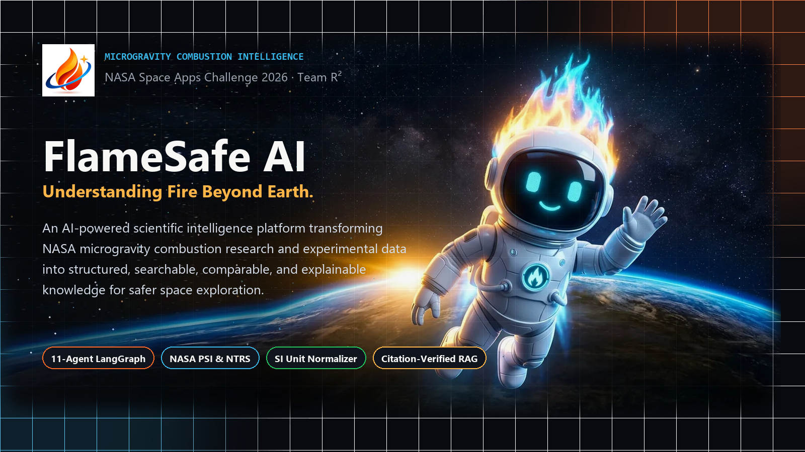

</div>

---

## Table of Contents

1. [About FlameSafe AI](#about-flamesafe-ai)
2. [Why Microgravity Combustion Matters](#why-microgravity-combustion-matters)
3. [Explore the Platform](#explore-the-platform)
4. [Platform Capabilities](#platform-capabilities)
5. [NASA PSI Research](#nasa-psi-research)
6. [Multi-Agent AI System](#multi-agent-ai-system)
7. [Scientific Data Engine](#scientific-data-engine)
8. [RAG and Evidence Intelligence](#rag-and-evidence-intelligence)
9. [Research Analysis and Decision Support](#research-analysis-and-decision-support)
10. [Earth Applications and Research Gaps](#earth-applications-and-research-gaps)
11. [Technical Architecture](#technical-architecture)
12. [Technology Stack](#technology-stack)
13. [Project Structure](#project-structure)
14. [Local Installation](#local-installation)
15. [Configuration](#configuration)
16. [API Documentation](#api-documentation)
17. [Testing](#testing)
18. [Deployment](#deployment)
19. [Scientific Integrity](#scientific-integrity)
20. [Team and Credits](#team-and-credits)
21. [License](#license)

---

## About FlameSafe AI

Orbital and deep-space missions depend on accurate fire prevention, detection, and suppression models. Decades of flight experiments aboard the **International Space Station (ISS)** and **Cygnus** vehicles are published across **NASA Physical Sciences Informatics (PSI)** and the **NASA Technical Reports Server (NTRS)**, yet key parameters remain fragmented across heterogeneous PDFs, spreadsheets, and incompatible unit systems.

**FlameSafe AI** solves this by indexing public flight campaigns into a unified, unit-normalized, provenance-tracked research platform—combining a **Next.js 15** interactive scientific workspace with a **FastAPI + LangGraph** 11-agent backend, deterministic dataset engine, and citation-verified RAG assistant.

**Target Users:** Aerospace fire-safety engineers, Environmental Control and Life Support System (ECLSS) architects, microgravity combustion researchers, and technical reviewers.

---

## Why Microgravity Combustion Matters


*Conceptual scientific visualization (not NASA experimental footage).*

- **Loss of Buoyant Convection (`~0g`):** Without gravity-driven rising plumes, hot gases linger around the fuel surface while molecular diffusion and low-speed spacecraft HVAC ventilation (`1–20 cm/s`) govern oxygen delivery.
- **Altered Extinction & Smoke Dynamics:** Solid polymers can sustain combustion at lower oxygen concentrations in low-speed orbital flow, while smoke aerosols agglomerate into larger particles that challenge terrestrial detector calibrations.
- **Exploration Atmosphere Gaps (`0.166g` Lunar / `0.38g` Mars):** Future habitats plan elevated-oxygen (`~34% O2`), reduced-pressure (`~56.5 kPa`) atmospheres where direct partial-gravity flight data remains sparse.

---

## Explore the Platform

FlameSafe AI opens with an orbital mission experience featuring an interactive Three.js 3D hero, live repository telemetry counters, and direct entry into every analytical module.


---

## Platform Capabilities

| Capability | Route / Docs | Summary | Status |
| :--- | :--- | :--- | :--- |
| **Mission Control** | [`/dashboard`](docs/features/mission-control.md) | Repository KPIs, domain coverage charts, fuel breakdown, and workflow counts | `IMPLEMENTED AND TESTED` |
| **NASA PSI Explorer** | [`/investigations`](docs/features/investigations.md) | Multi-facet campaign search, experimental runs, SI metrics, and DOI documents | `IMPLEMENTED AND TESTED` |
| **AI Lab (11-Agent System)** | [`/research`](docs/features/ai-lab.md) | LangGraph research requests, HITL approval gates, and checkpoint recovery | `IMPLEMENTED AND TESTED` |
| **Dynamic Dataset Engine** | [`/research`](docs/features/ai-lab.md) | Content fingerprinting, semantic versioning, lineage, and Parquet/CSV/JSON export | `IMPLEMENTED AND TESTED` |
| **Data Observatory** | [`/compare`](docs/features/data-observatory.md) | Side-by-side matrix (2–4 studies), radar coverage, and 1g vs 0g vs 0.16g view | `IMPLEMENTED AND TESTED` |
| **Decision Lab & Gap Intelligence** | [`/scenarios`](docs/features/decision-lab.md) | Habitat O2/pressure/flow coverage evaluation and research gap detection | `IMPLEMENTED AND TESTED` |
| **Research Insights** | [`/insights`](docs/features/insights.md) | Weighted `RelevanceScorer` ranking across fire safety decision modes | `IMPLEMENTED AND TESTED` |
| **Evidence & Citation Vault** | [`/evidence`](docs/features/evidence.md) | Searchable DOI/NTRS primary literature and JSON report export | `IMPLEMENTED AND TESTED` |
| **Astro-Flame Companion** | [`/assistant`](docs/features/astro-flame.md) | Citation-verified RAG assistant with abstention protocol | `IMPLEMENTED AND TESTED` |
| **Earth Applications** | [`/`](frontend/app/page.tsx) | Landing-page module highlighting terrestrial clean-combustion & detector spin-offs | `IMPLEMENTED` |
| **Multi-Tenant Auth & RBAC** | — | User accounts, team workspaces, and role-based approval policies | `PLANNED` |

### Mission Control (`/dashboard`)

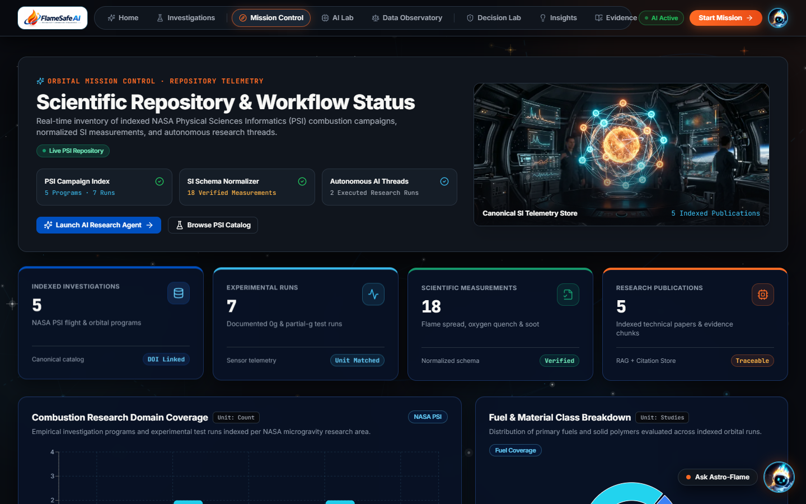

---

## NASA PSI Research

FlameSafe AI seeds and indexes **5 canonical NASA microgravity combustion flight programs** in the primary relational database (`AGENT_04` catalogs 11 campaigns for discovery):

| Acronym | Program Title | Facility & Platform | Stored DOI |
| :--- | :--- | :--- | :--- |
| **BASS** | Burning and Suppression of Solids (BASS & BASS-II) | Microgravity Science Glovebox (MSG) · ISS | `10.1016/j.combustflame.2015.08.012` |
| **SAFFIRE** | Spacecraft Fire Safety Demonstration (Saffire I–VI) | Cygnus Automated Transfer Vehicle | `10.1016/j.firesaf.2019.102874` |
| **FLEX** | Flame Extinguishment Experiment (FLEX & FLEX-2) | Combustion Integrated Rack (CIR / MDCA) · ISS | `10.1016/j.combustflame.2014.01.019` |
| **SAME** | Smoke Aerosol Measurement Experiment (SAME / SAME-R) | Microgravity Science Glovebox (MSG) · ISS | `10.4271/2009-01-2481` |
| **ACME** | Advanced Combustion via Microgravity Experiments | Combustion Integrated Rack (CIR) · ISS | `10.1016/j.proci.2020.06.154` |

<table>
  <tr>
    <td width="50%">
      <strong>PSI Investigation Explorer (<code>/investigations</code>)</strong><br />
      
    </td>
    <td width="50%">
      <strong>Investigation Profile &amp; Runs (<code>/investigations/inv-bass-001</code>)</strong><br />
      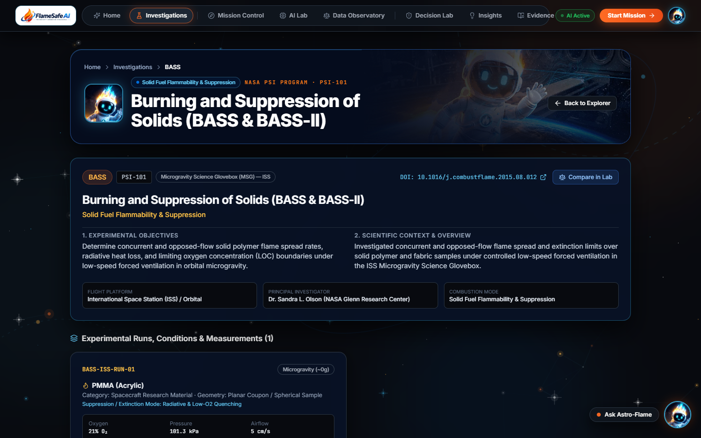
    </td>
  </tr>
</table>

---

## Multi-Agent AI System


**AGENT 01 (`ChiefIntelligenceOrchestrator`)** runs a compiled **LangGraph `StateGraph`** (`backend/app/agents/orchestrator/supervisor.py`), persisting `AgentRun`, `WorkflowEvent`, and `AgentCheckpoint` rows to SQLAlchemy. Only `AGENT_02` and `AGENT_11` call the configured LLM (`gemini-3.8-flash` or deterministic mock fallback); the remaining nodes execute deterministic scientific, security, and validation logic.

| Agent ID | Canonical Name | Primary Responsibility | Execution Type |
| :--- | :--- | :--- | :--- |
| `AGENT_01` | Chief Intelligence Orchestrator | LangGraph `StateGraph` routing, checkpoints, and HITL gates | Orchestration |
| `AGENT_02` | Query Understanding Agent | Decomposes question into fuel, gravity regime, and variables | LLM-assisted / Fallback |
| `AGENT_03` | Existing Knowledge & Reuse Agent | Audits local DB and existing datasets for reusable records | Deterministic |
| `AGENT_04` | NASA PSI Discovery Agent | Searches and ranks 11 NASA PSI combustion campaigns | Deterministic |
| `AGENT_05` | File Intelligence & Selection Agent | Priority scoring (`F = 0.35Q + 0.25T + 0.20C + 0.10P + 0.10A`); excludes video | Deterministic |
| `AGENT_06` | Scientific Acquisition Agent | SSRF allowlist guard, 25 MB cap, and SHA-256 vaulting | Deterministic |
| `AGENT_07` | Scientific Extraction Agent | Extracts structured tabular and publication run records | Deterministic |
| `AGENT_08` | Scientific Schema Mapping Agent | Maps records to canonical schema and SI units | Deterministic |
| `AGENT_09` | Validation & Quality Agent | Physical bounds checking and strict `null` preservation | Deterministic |
| `AGENT_10` | Dynamic Dataset Builder Agent | Content fingerprinting, semantic versioning, Parquet/CSV/JSON | Deterministic |
| `AGENT_11` | Research Intelligence Agent | RAG synthesis with DOI and page citation verification | LLM-assisted / Fallback |

<table>
  <tr>
    <td width="50%">
      <strong>AI Research Intelligence Lab (<code>/research</code>)</strong><br />
      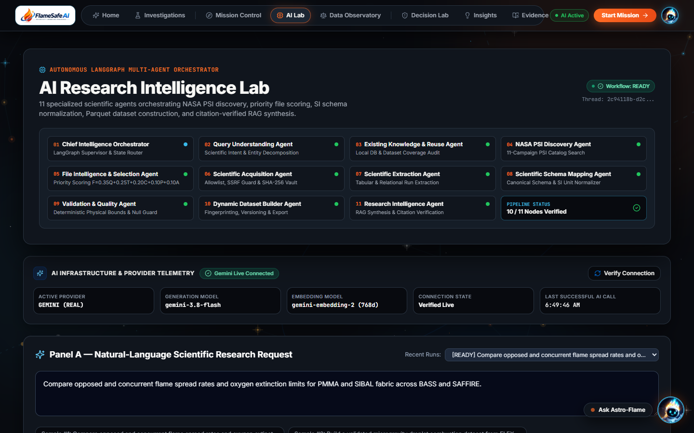
    </td>
    <td width="50%">
      <strong>Workflow Controls &amp; Dataset Inspector (<code>/research</code>)</strong><br />
      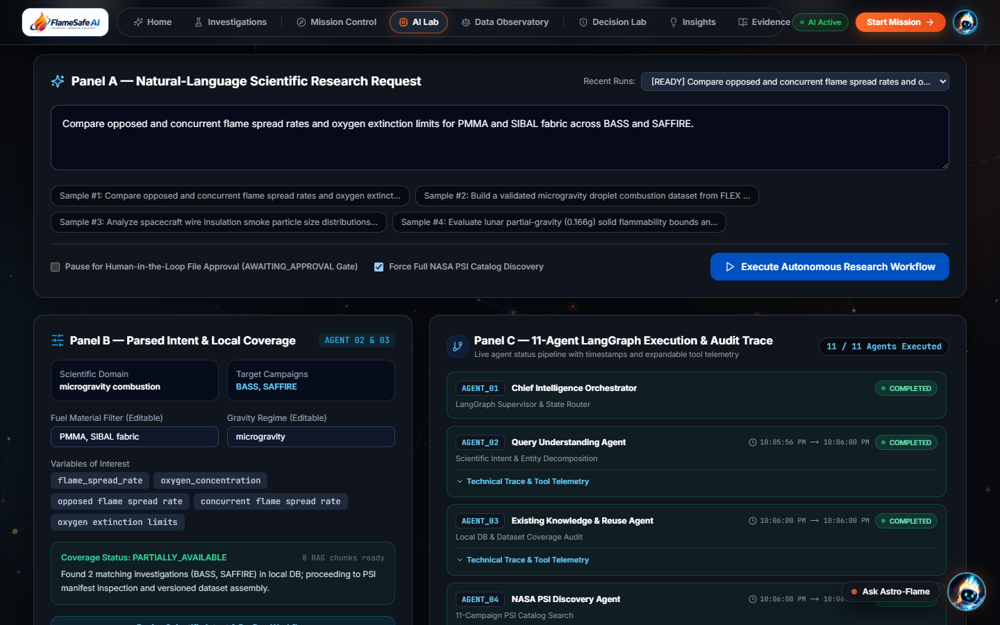
    </td>
  </tr>
</table>

See [Multi-Agent Workflow Diagram](docs/architecture/multi-agent-workflow.md).

---

## Scientific Data Engine


- **SI Normalization & Null Guard:** Normalizes pressure (`kPa`), airflow (`cm/s`), oxygen (`% O2`), and flame spread rate while keeping unrecorded values as `null` (`Not recorded` in the UI).
- **Lineage & Versioning:** Every `DatasetItem` traces through a 6-step provenance chain back to its `ExperimentalRun`, `Investigation`, DOI, and page reference (`GET /api/v1/datasets/{id}/lineage`).
- **Real Analytical Exports:** Generates `Apache Parquet` (via `pyarrow`), `CSV`, and `JSON` exports alongside a Pandas analytical workspace (`POST /api/v1/datasets/{id}/analytics`).

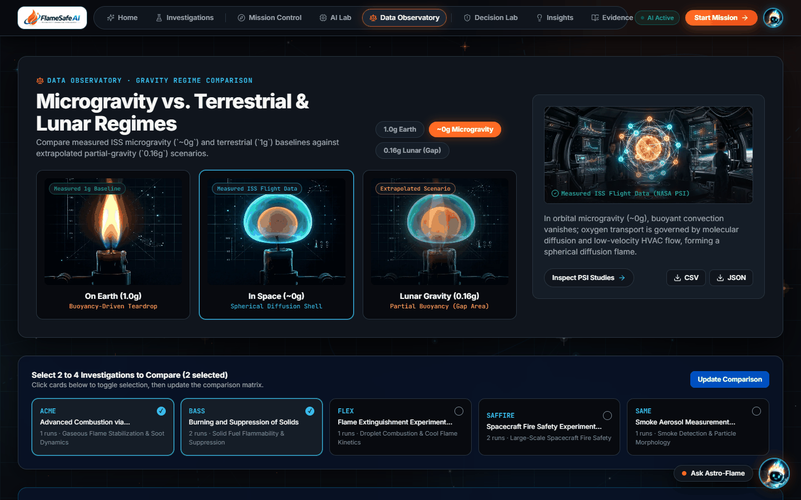

See [Scientific Data Lifecycle](docs/architecture/data-lifecycle.md).

---

## RAG and Evidence Intelligence

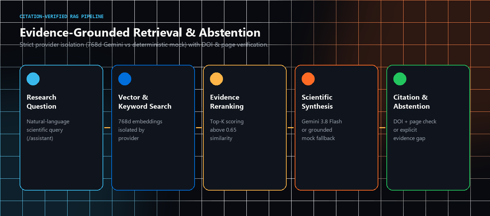

- **Provider Isolation:** Supports live `gemini-embedding-2` (`768` dims) and deterministic SHA-256 `MockEmbeddingProvider`, tagged by `embedding_provider` so vector spaces are never mixed.
- **Citation Verification & Abstention:** Cross-checks DOIs and acronyms against retrieved `EvidenceChunk` records and abstains when similarity falls below `SIMILARITY_THRESHOLD` (`0.65`).

<table>
  <tr>
    <td width="50%">
      <strong>Evidence &amp; Citation Vault (<code>/evidence</code>)</strong><br />
      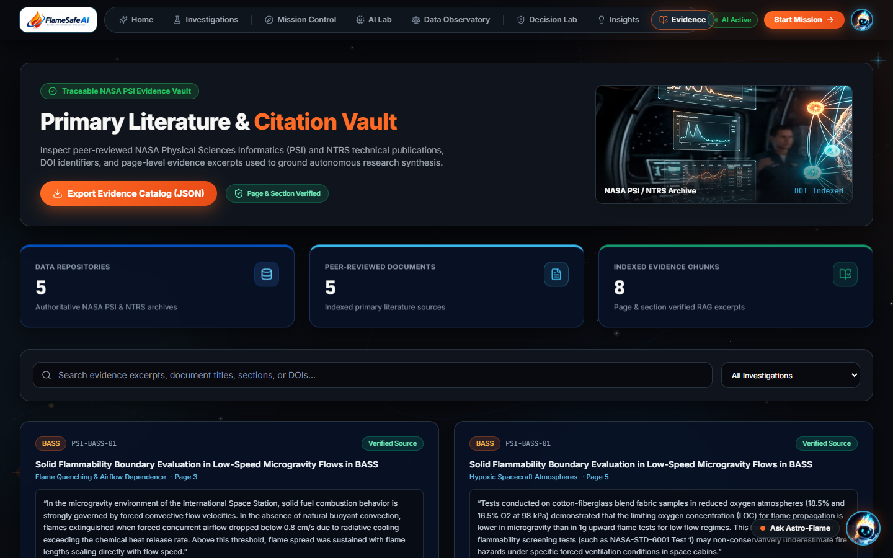
    </td>
    <td width="50%">
      <strong>Astro-Flame RAG Companion (<code>/assistant</code>)</strong><br />
      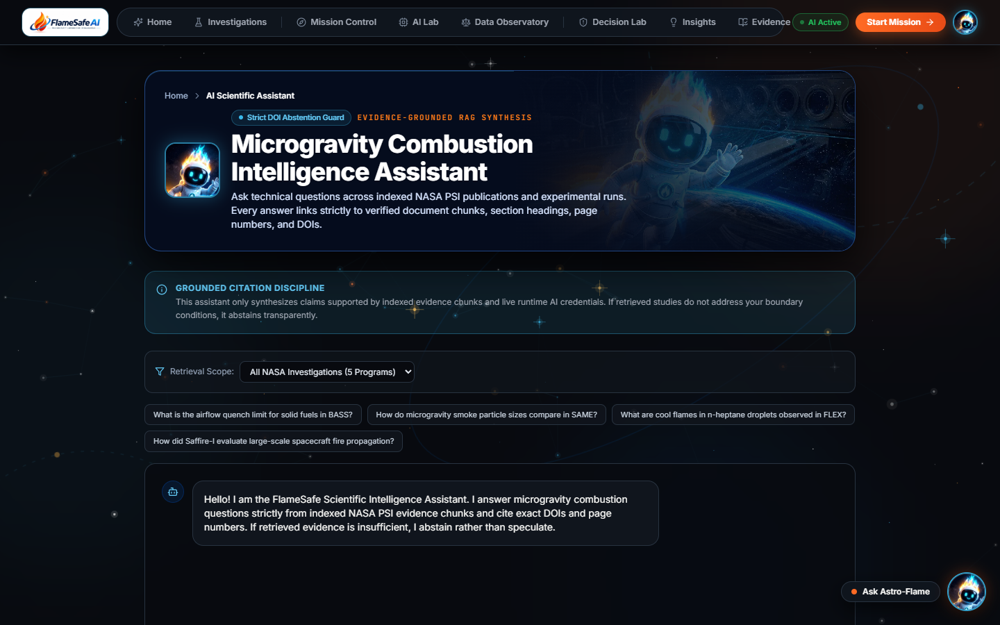
    </td>
  </tr>
</table>

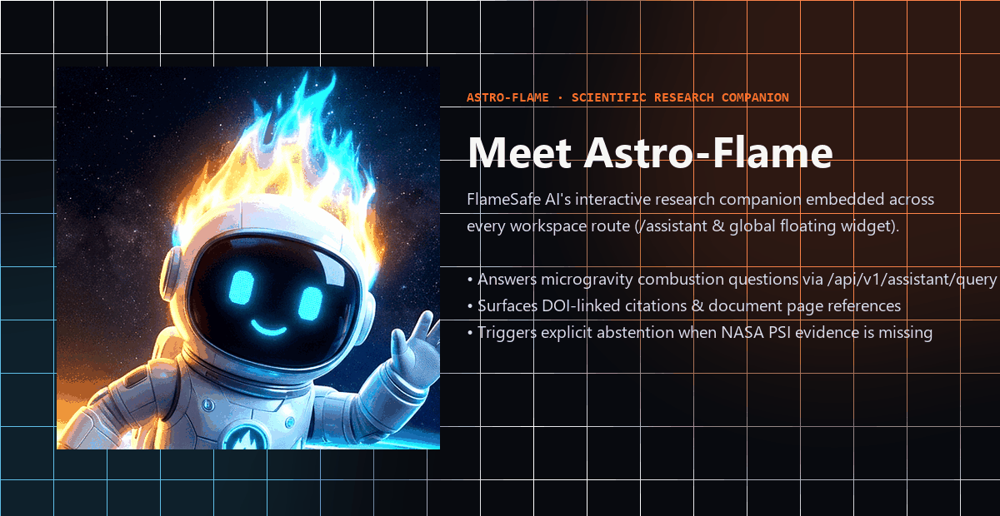

See [RAG Pipeline Architecture](docs/architecture/rag-pipeline.md).

---

## Research Analysis and Decision Support

<table>
  <tr>
    <td width="50%">
      <strong>Decision Lab &amp; Gap Intelligence (<code>/scenarios</code>)</strong><br />
      
    </td>
    <td width="50%">
      <strong>Scientific Relevance Insights (<code>/insights</code>)</strong><br />
      
    </td>
  </tr>
</table>

- **Decision Lab (`/scenarios`):** Evaluates target habitat conditions against empirical NASA PSI runs (`Exact Match`, `Partial Match`, `Extrapolated Regime`, `Unsupported Condition`). The *Condition Sensitivity Indicator* is a heuristic boundary proximity score—**not** a calibrated fire ignition probability.
- **Insights (`/insights`):** Uses `RelevanceScorer` (`backend/app/ranking/scoring.py`) to rank investigations across Fire Prevention, Fire Detection, Fire Suppression, and Material Selection modes.

---

## Earth Applications and Research Gaps

- **Earth Applications (`IMPLEMENTED` on `/`):** Summarizes terrestrial spin-offs from microgravity combustion research, including clean combustion kinetics (`FLEX` cool flames) and aerosol detector calibration (`SAME`).
- **Research Gap Intelligence (`IMPLEMENTED AND TESTED` on `/scenarios` & `/`):** Isolates under-tested parameter combinations—particularly partial-gravity (`0.166g` Lunar, `0.38g` Mars) hypoxic exploration atmospheres—from verified ISS `~0g` data.

---

## Technical Architecture

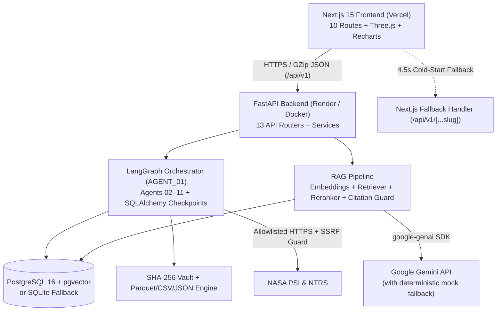

Full architecture documentation: [System Architecture](docs/architecture/system-architecture.md) · [Multi-Agent Workflow](docs/architecture/multi-agent-workflow.md) · [Database ERD](docs/architecture/database-schema.md) · [Research Workflow](docs/architecture/research-workflow.md) · [Deployment Architecture](docs/architecture/deployment.md).

---

## Technology Stack

| Category | Verified Technologies |
| :--- | :--- |
| **Frontend** | Next.js 15, React 19 RC, TypeScript 5.6, Tailwind CSS 3.4, Three.js 0.187, Recharts 2.13, Lucide React |
| **Backend** | Python 3.11+, FastAPI, Uvicorn, Pydantic v2, SQLAlchemy 2 (Async), Alembic |
| **Database** | PostgreSQL 16 + `pgvector` (`asyncpg`), automatic SQLite + `aiosqlite` fallback |
| **AI & Multi-Agent** | LangGraph `StateGraph`, `google-genai` (`gemini-3.8-flash`, `gemini-embedding-2`), deterministic mock fallback |
| **Scientific Data** | Pandas, NumPy, PyArrow (Apache Parquet), PyMuPDF |
| **Infrastructure** | Docker, Docker Compose, GitHub Actions CI, Render, Vercel |

---

## Project Structure

```text
FLAMESAFE-AI/
├── .github/workflows/ci.yml      # Ruff, Pytest, Typecheck, Unit tests, Next.js build
├── backend/
│   ├── app/
│   │   ├── agents/               # LangGraph StateGraph (AGENT_01) & Nodes (AGENT_02–11)
│   │   ├── api/v1/endpoints/     # 13 FastAPI route modules (/api/v1/*)
│   │   ├── connectors/psi/       # NASA PSI catalog, file manifest, SSRF validator
│   │   ├── core/                 # Config, async DB + SQLite fallback, logging, exceptions
│   │   ├── datasets/             # Fingerprinting, versioning, quality, lineage, Parquet, Pandas
│   │   ├── ingestion/            # Extractors, SI unit normalizer, scientific validator
│   │   ├── models/               # SQLAlchemy ORM models (core + multi-agent)
│   │   ├── rag/                  # Chunker, Gemini/mock embeddings, retriever, reranker, citations
│   │   ├── ranking/              # Weighted RelevanceScorer & explainability
│   │   └── services/             # Comparison, investigation, ranking, scenario, AI services
│   ├── migrations/versions/      # Alembic migrations 001–004
│   ├── scripts/                  # Seed, migration, backfill, and live PSI smoke scripts
│   ├── Dockerfile
│   └── requirements.txt
├── frontend/
│   ├── app/                      # Next.js 15 App Router pages + /api/v1/[...slug] fallback
│   ├── components/               # Modular UI, charts, Three.js hero, Astro-Flame companion
│   ├── hooks/                    # React data hooks
│   ├── lib/api/                  # API client (caching, cold-start warmup, fallback)
│   ├── public/                   # Official brand logos, favicons, and WebP story assets
│   ├── tests/                    # Node unit tests
│   └── vercel.json
├── docs/                         # Documentation hub, architecture diagrams, features & screenshots
├── docker-compose.yml
├── render.yaml
├── .env.example
├── CONTRIBUTING.md
├── SECURITY.md
└── LICENSE
```

---

## Local Installation

```bash
git clone https://github.com/GhariebML/FLAMESAFE-AI.git
cd FLAMESAFE-AI
cp .env.example .env
cp frontend/.env.example frontend/.env.local
```

**Option 1 — Standalone Local Run (SQLite Fallback, No Docker Required):**
```bash
# Terminal 1: Backend
cd backend
python -m venv .venv
pip install --upgrade pip && pip install -r requirements.txt
uvicorn app.main:app --reload --host 0.0.0.0 --port 8001

# Terminal 2: Frontend
cd frontend
npm install && npm run dev
```

**Option 2 — Full Stack via Docker Compose (`PostgreSQL 16 + pgvector`):**
```bash
docker compose up --build
```

See [Local Setup Guide](docs/development/local-setup.md) for Windows PowerShell activation and Alembic migration commands.

---

## Configuration

See [Environment Variables Reference](docs/development/environment-variables.md) for all verified backend and frontend settings (`DATABASE_URL`, `USE_SQLITE_FALLBACK`, `AI_PROVIDER`, `GEMINI_API_KEY`, `NEXT_PUBLIC_API_URL`, `ALLOWED_ORIGINS`). Never commit `.env` or `.env.local` files.

---

## API Documentation

- **Complete Route Reference:** [docs/api/README.md](docs/api/README.md)
- **Interactive Swagger UI:** `/docs` on a running FastAPI instance (`openapi_url: /api/v1/openapi.json`)

---

## Testing

```bash
# Backend unit & integration suite (41 passed, 1 live-Gemini test skipped without live key)
cd backend && pytest -v

# Frontend lint, typecheck, unit tests (12 passed), and Next.js production build
cd frontend && npm run lint && npm run typecheck && npm test && npm run build
```

---

## Deployment

Configured for **Vercel** (`frontend/vercel.json`) and **Render** (`render.yaml`, `Dockerfile`).

See [Render & Vercel Deployment Guide](docs/deployment/render.md).

---

## Scientific Integrity

- **Zero Fabricated Metrics:** Unrecorded measurements remain `null` (`Not recorded`), never interpolated or zero-filled.
- **No Unfounded Probability Claims:** `RelevanceScorer` and *Condition Sensitivity Indicator* are heuristic metrics, not calibrated fire probabilities.
- **Provenance & Abstention:** Every RAG answer links to verified DOIs/pages or triggers an explicit abstention when evidence is missing.

See [Scientific Integrity Policy](docs/scientific/scientific-integrity.md) and [SECURITY.md](SECURITY.md).

---

## Team and Credits

Developed by **Team R²** for the **2026 NASA Space Apps Challenge (Cairo)**:

**Mohamed Gharieb · Toka Reda · Mai Hamdy · Amany Atef**

---

## License

Released under the [MIT License](LICENSE).
