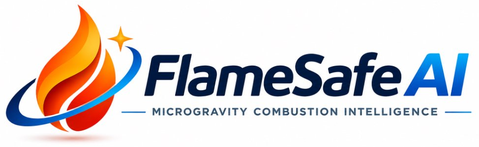
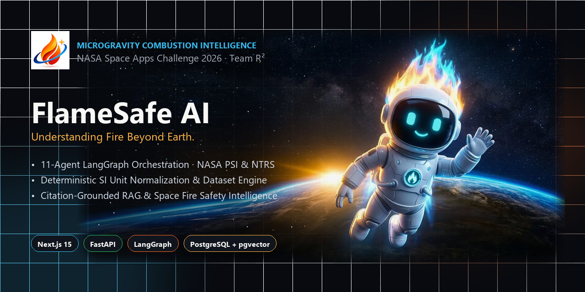
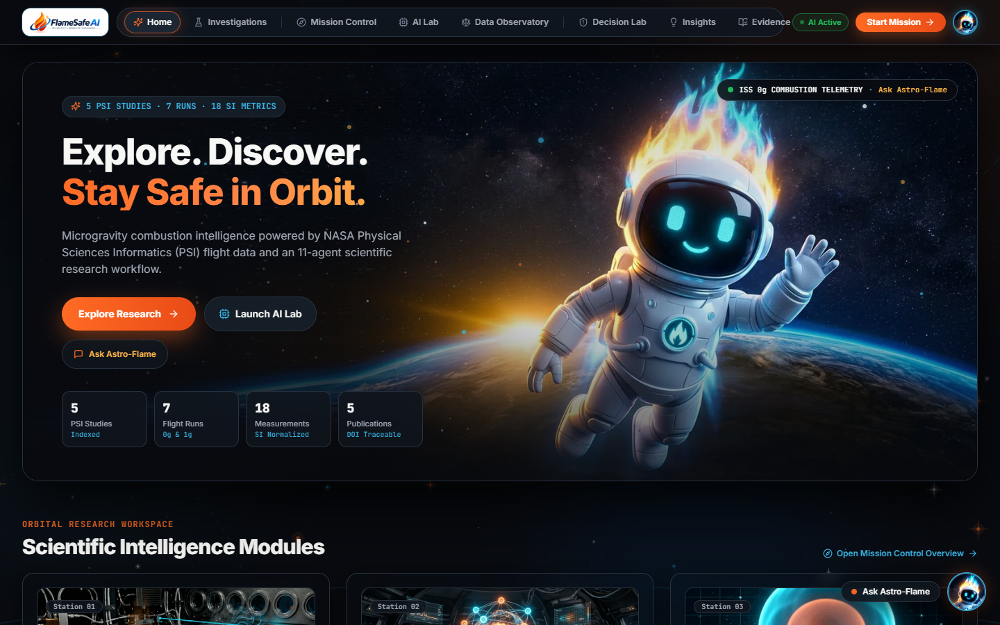
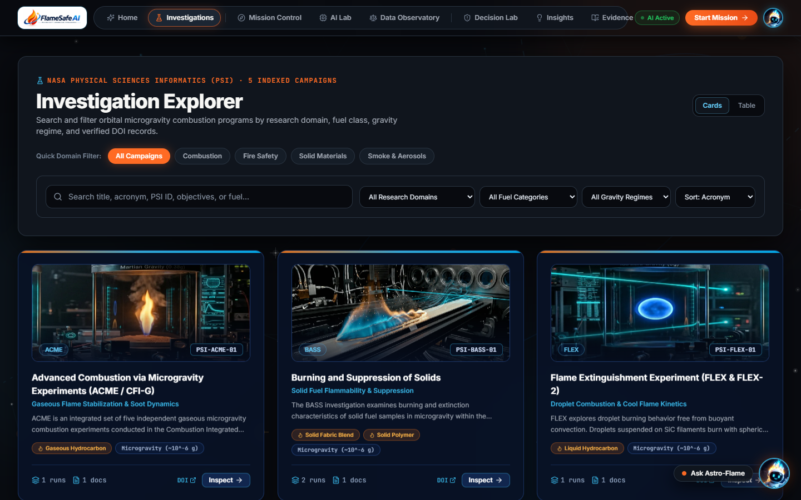
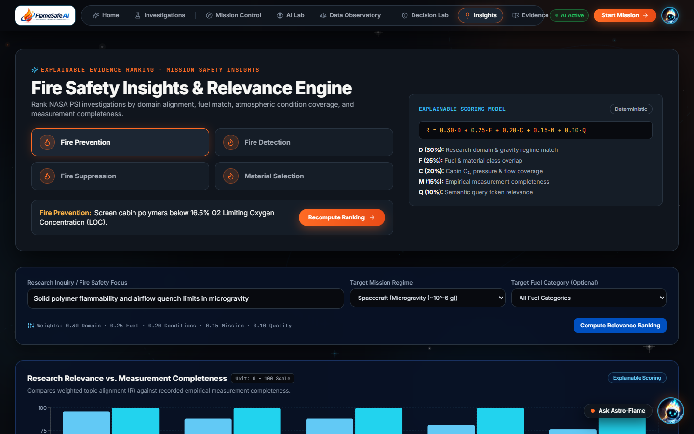
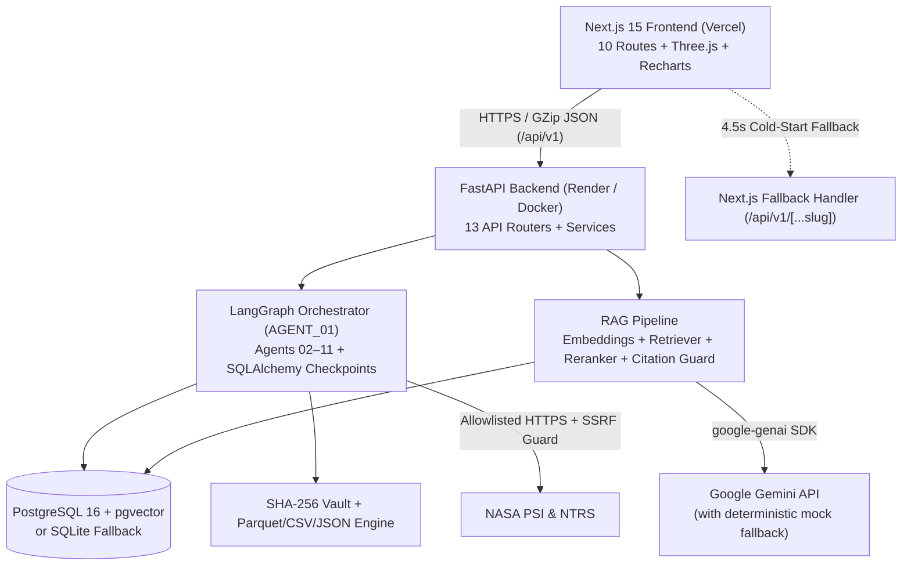

<div align="center">



# FlameSafe AI

### **MICROGRAVITY COMBUSTION INTELLIGENCE**

**Understanding Fire Beyond Earth.**

An AI-powered scientific intelligence platform transforming NASA microgravity combustion research and experimental data into structured, searchable, comparable, and explainable knowledge for safer space exploration.

*Developed by Team R² for the **NASA Space Apps Challenge 2026**. FlameSafe AI is an independent open-source research platform using public NASA Physical Sciences Informatics (PSI) and NTRS resources; no official NASA sponsorship, endorsement, or partnership is implied.*

[](frontend/package.json)
[](frontend/tsconfig.json)
[](backend/app/main.py)
[](backend/requirements.txt)
[](backend/app/agents/orchestrator/supervisor.py)
[](docker-compose.yml)
[](Dockerfile)
[](LICENSE)

<br />



</div>

---

## Table of Contents

- [Overview](#overview)
- [Why FlameSafe AI?](#why-flamesafe-ai)
- [Core Features](#core-features)
- [Platform Screenshots](#platform-screenshots)
- [System Architecture](#system-architecture)
- [Multi-Agent AI System](#multi-agent-ai-system)
- [Scientific Data Pipeline](#scientific-data-pipeline)
- [RAG and Evidence Intelligence](#rag-and-evidence-intelligence)
- [NASA PSI Investigations](#nasa-psi-investigations)
- [Technology Stack](#technology-stack)
- [Repository Structure](#repository-structure)
- [Local Installation & Quick Start](#local-installation--quick-start)
- [Environment Configuration](#environment-configuration)
- [API Documentation](#api-documentation)
- [Testing](#testing)
- [Deployment](#deployment)
- [Scientific Integrity](#scientific-integrity)
- [Security](#security)
- [Limitations & Roadmap](#limitations--roadmap)
- [Team & License](#team--license)

---

## Overview

Combustion in orbital microgravity (`~0g`) behaves fundamentally differently from fire on Earth (`1g`). Without buoyancy-driven convection, hot gases do not rise rapidly; instead, diffusion and low-velocity spacecraft HVAC airflow govern flame geometry, soot agglomeration, cool-flame persistence, and extinction limits.

Decades of orbital flight experiments aboard the **International Space Station (ISS)** and **Cygnus** vehicles have generated rich experimental records across **NASA Physical Sciences Informatics (PSI)** and the **NASA Technical Reports Server (NTRS)**. However, key parameters—oxygen concentration, ambient pressure, forced airflow velocity, and flame spread rate—are dispersed across heterogeneous PDFs, tables, and unit systems.

**FlameSafe AI** organizes these public flight campaigns into a unified, unit-normalized, provenance-tracked research environment for aerospace fire safety engineers, ECLSS architects, and combustion researchers.

---

## Why FlameSafe AI?

1. **Eliminates Unit & Regime Conflation:** Normalizes pressure (`kPa`), airflow (`cm/s`), oxygen (`% O2`), and spread rates while keeping `null` measurements explicit (`Not recorded`).
2. **Separates Measured Data from Extrapolation:** Distinguishes ISS `~0g` flight measurements from extrapolated **Lunar (`0.166g`)** and **Martian (`0.38g`)** exploration atmospheres.
3. **11-Agent Autonomous Research Pipeline:** Uses a LangGraph `StateGraph` with SQLAlchemy checkpointing, SSRF-guarded NASA PSI acquisition, PyArrow Parquet exports, and human-in-the-loop approval gates.
4. **Citation-Verified RAG + Abstention:** Grounds Q&A responses in DOI-linked `EvidenceChunk` excerpts and abstains when empirical evidence is insufficient.

---

## Core Features

| Module | Route / Implementation | Purpose & Target Users | Status |
| :--- | :--- | :--- | :--- |
| **Orbital Landing & 3D Hero** | `/` (`frontend/app/page.tsx`) | Interactive Three.js 3D hero, platform story, and Astro-Flame companion entry | `IMPLEMENTED` |
| **Mission Control** | `/dashboard` (`frontend/app/dashboard/page.tsx`) | Repository KPIs, domain coverage charts, and workflow telemetry | `IMPLEMENTED — TESTED` |
| **NASA PSI Explorer** | `/investigations`, `/investigations/[id]` | Multi-facet search, run inspection, measurements, and DOI documents | `IMPLEMENTED — TESTED` |
| **AI Lab (11-Agent Workflow)** | `/research` (`backend/app/agents/`) | Natural-language research requests, HITL approval, checkpoint recovery | `IMPLEMENTED — TESTED` |
| **Dynamic Dataset Engine** | `/research` (`backend/app/datasets/`) | Content fingerprinting, semantic versioning, lineage, JSON/CSV/Parquet export | `IMPLEMENTED — TESTED` |
| **Pandas Analytical Workspace** | `POST /api/v1/datasets/{id}/analytics` | Grouping, filtering, and unit-guarded numeric aggregations | `IMPLEMENTED — TESTED` |
| **Data Observatory** | `/compare` (`backend/app/services/comparison_service.py`) | Side-by-side matrix (2–4 studies), radar coverage, 1g vs 0g vs 0.16g view | `IMPLEMENTED — TESTED` |
| **Decision Lab & Gap Intelligence** | `/scenarios` (`backend/app/services/scenario_service.py`) | Habitat O2/pressure/flow coverage evaluation & research gap identification | `IMPLEMENTED — TESTED` |
| **Scientific Relevance Insights** | `/insights` (`backend/app/ranking/scoring.py`) | Explainable multi-factor ranking (`RelevanceScorer`) by decision mode | `IMPLEMENTED — TESTED` |
| **Evidence & Citation Vault** | `/evidence` (`backend/app/api/v1/endpoints/sources.py`) | Searchable DOI/NTRS catalog and JSON report export | `IMPLEMENTED — TESTED` |
| **Astro-Flame RAG Companion** | `/assistant` & floating widget (`backend/app/rag/`) | Evidence-grounded scientific Q&A with citation verification | `IMPLEMENTED — TESTED` |
| **Multi-Tenant Auth & RBAC** | — | User accounts, team workspaces, and role-based approval policies | `PLANNED` |

---

## Platform Screenshots

All screenshots below were captured directly from the running FlameSafe AI application at `1440×900`.

<table>
  <tr>
    <td width="50%">
      <strong>Homepage &amp; 3D Orbital Hero (<code>/</code>)</strong><br />
      
    </td>
    <td width="50%">
      <strong>Mission Control Telemetry (<code>/dashboard</code>)</strong><br />
      
    </td>
  </tr>
  <tr>
    <td width="50%">
      <strong>NASA PSI Investigation Explorer (<code>/investigations</code>)</strong><br />
      
    </td>
    <td width="50%">
      <strong>Investigation Profile &amp; Runs (<code>/investigations/inv-bass-001</code>)</strong><br />
      
    </td>
  </tr>
  <tr>
    <td width="50%">
      <strong>AI Research Intelligence Lab (<code>/research</code>)</strong><br />
      
    </td>
    <td width="50%">
      <strong>11-Agent Workflow &amp; Telemetry (<code>/research</code>)</strong><br />
      
    </td>
  </tr>
  <tr>
    <td width="50%">
      <strong>Data Observatory &amp; Gravity Regimes (<code>/compare</code>)</strong><br />
      
    </td>
    <td width="50%">
      <strong>Decision Lab &amp; Gap Intelligence (<code>/scenarios</code>)</strong><br />
      
    </td>
  </tr>
  <tr>
    <td width="50%">
      <strong>Research Insights &amp; Ranking (<code>/insights</code>)</strong><br />
      
    </td>
    <td width="50%">
      <strong>Evidence &amp; Citation Vault (<code>/evidence</code>)</strong><br />
      
    </td>
  </tr>
</table>

<details>
<summary>View Astro-Flame RAG Companion Screenshot (<code>/assistant</code>)</summary>
<br />

</details>

---

## System Architecture



Detailed architecture documents:
- [System Architecture](docs/architecture/system-architecture.md)
- [Database Schema & ERD](docs/architecture/database-schema.md)
- [Deployment Architecture](docs/architecture/deployment.md)

---

## Multi-Agent AI System

FlameSafe AI uses **one compiled LangGraph `StateGraph`** (`backend/app/agents/orchestrator/supervisor.py`) where `AGENT_01` coordinates 10 specialized workflow nodes (`AGENT_02`–`AGENT_11`). Most nodes execute deterministic scientific/validation logic; `AGENT_02` and `AGENT_11` call the configured LLM provider (`gemini-3.8-flash` or deterministic mock fallback).

| Agent ID | Canonical Name (`supervisor.py`) | Primary Responsibility | Execution Type |
| :--- | :--- | :--- | :--- |
| `AGENT_01` | Chief Intelligence Orchestrator | LangGraph `StateGraph` routing, `AgentRun`, `WorkflowEvent`, `AgentCheckpoint` | Orchestration |
| `AGENT_02` | Query Understanding Agent | Decomposes natural-language question into fuel, gravity, and variables | LLM-assisted / Fallback |
| `AGENT_03` | Existing Knowledge & Reuse Agent | Audits local DB & existing datasets for reusable records | Deterministic |
| `AGENT_04` | NASA PSI Discovery Agent | Searches and ranks 11 NASA PSI combustion campaigns | Deterministic |
| `AGENT_05` | File Intelligence & Selection Agent | Scores files (`F = 0.35Q + 0.25T + 0.20C + 0.10P + 0.10A`), excludes raw video | Deterministic |
| `AGENT_06` | Scientific Acquisition Agent | Runs `PSISourceValidator` SSRF guard, 25 MB cap, and SHA-256 vaulting | Deterministic |
| `AGENT_07` | Scientific Extraction Agent | Extracts structured tabular and publication run records | Deterministic |
| `AGENT_08` | Scientific Schema Mapping Agent | Maps records to canonical schema and SI units | Deterministic |
| `AGENT_09` | Validation & Quality Agent | Enforces physical bounds and preserves `null` missing values | Deterministic |
| `AGENT_10` | Dynamic Dataset Builder Agent | Computes content fingerprint, semantic version, and Parquet/CSV/JSON exports | Deterministic |
| `AGENT_11` | Research Intelligence Agent | Synthesizes RAG report with verified DOI/page citations | LLM-assisted / Fallback |

See [Multi-Agent Workflow Architecture](docs/architecture/multi-agent-workflow.md).

---

## Scientific Data Pipeline

```text
NASA PSI / NTRS Discovery -> File Governance & SHA-256 Vault -> PyMuPDF / Tabular Extraction
-> SI Unit Normalizer -> Deterministic Bounds & Null Guard -> Fingerprinted Dataset -> Parquet / CSV / JSON Export
```

- **Null Preservation:** Missing experimental measurements remain `null` (`Not recorded` in UI) and are never fabricated or zero-filled.
- **Lineage & Versioning:** Every dataset item traces through a 6-step provenance chain back to its `ExperimentalRun`, `Investigation`, DOI, and page reference.
- **Export Formats:** Real `Apache Parquet` (via `pyarrow`), `CSV`, and `JSON` exports.

See [Scientific Data Lifecycle](docs/architecture/data-lifecycle.md).

---

## RAG and Evidence Intelligence

- **Embeddings:** `GeminiEmbeddingProvider` (`gemini-embedding-2`, `768` dimensions) when `GEMINI_API_KEY` is configured, or deterministic SHA-256 mock embeddings (`MockEmbeddingProvider`) for offline/CI runs.
- **Provider Isolation:** `evidence_chunks` tracks `embedding_provider` and `embedding_dimension` so Gemini vectors and mock vectors are never mixed in similarity searches.
- **Reranking & Abstention:** Retrieves top-K chunks, reranks by relevance, and triggers an explicit abstention protocol when evidence falls below `SIMILARITY_THRESHOLD` (`0.65`).
- **Live Telemetry:** `GET /api/v1/ai/status` reports `is_mock_provider: true` whenever the deterministic synthesizer is active.

See [RAG Pipeline Architecture](docs/architecture/rag-pipeline.md).

---

## NASA PSI Investigations

FlameSafe AI seeds and indexes **5 canonical NASA microgravity combustion campaigns** in the primary relational store (while `AGENT_04` catalogs 11 PSI campaigns for discovery):

| Acronym | Program Title | Facility & Platform | Stored DOI |
| :--- | :--- | :--- | :--- |
| **BASS** | Burning and Suppression of Solids (BASS & BASS-II) | Microgravity Science Glovebox (MSG) · ISS | `10.1016/j.combustflame.2015.08.012` |
| **SAFFIRE** | Spacecraft Fire Safety Demonstration (Saffire I–VI) | Cygnus Automated Transfer Vehicle | `10.1016/j.firesaf.2019.102874` |
| **FLEX** | Flame Extinguishment Experiment (FLEX & FLEX-2) | Combustion Integrated Rack (CIR / MDCA) · ISS | `10.1016/j.combustflame.2014.01.019` |
| **SAME** | Smoke Aerosol Measurement Experiment (SAME / SAME-R) | Microgravity Science Glovebox (MSG) · ISS | `10.4271/2009-01-2481` |
| **ACME** | Advanced Combustion via Microgravity Experiments | Combustion Integrated Rack (CIR) · ISS | `10.1016/j.proci.2020.06.154` |

---

## Technology Stack

- **Frontend:** Next.js 15, React 19 RC, TypeScript 5.6, Tailwind CSS 3.4, Three.js 0.187, Recharts 2.13, Lucide React
- **Backend:** Python 3.11+, FastAPI, Uvicorn, Pydantic v2, SQLAlchemy 2 (Async), Alembic
- **Database:** PostgreSQL 16 + `pgvector` (`asyncpg`), automatic SQLite + `aiosqlite` fallback
- **AI & Data:** LangGraph, `google-genai` (`gemini-3.8-flash`, `gemini-embedding-2`), Pandas, NumPy, PyArrow, PyMuPDF
- **Infrastructure:** Docker, Docker Compose, GitHub Actions CI, Render, Vercel

---

## Repository Structure

```text
FLAMESAFE-AI/
├── .github/workflows/ci.yml      # GitHub Actions CI (Ruff, Pytest, Typecheck, Tests, Next build)
├── backend/
│   ├── app/
│   │   ├── agents/               # LangGraph StateGraph (AGENT_01) & Nodes (AGENT_02–11)
│   │   ├── api/v1/endpoints/     # 13 FastAPI route modules (/api/v1/*)
│   │   ├── connectors/psi/       # NASA PSI catalog, file manifest, SSRF validator
│   │   ├── core/                 # Config, async DB + SQLite fallback, logging, exceptions
│   │   ├── datasets/             # Fingerprinting, versioning, quality, lineage, Parquet, Pandas
│   │   ├── ingestion/            # Extractors, SI unit normalizer, scientific validator
│   │   ├── models/               # SQLAlchemy ORM models (core + multi-agent)
│   │   ├── rag/                  # Chunker, Gemini/mock embeddings, retriever, reranker, citations
│   │   ├── ranking/              # Weighted RelevanceScorer & explainability
│   │   └── services/             # Comparison, investigation, ranking, scenario, AI services
│   ├── migrations/versions/      # Alembic migrations 001–004
│   ├── scripts/                  # Seed, migration, backfill, and live PSI smoke scripts
│   ├── Dockerfile
│   └── requirements.txt
├── frontend/
│   ├── app/                      # Next.js 15 App Router pages + /api/v1/[...slug] fallback
│   ├── components/               # Modular UI, charts, Three.js hero, Astro-Flame companion
│   ├── hooks/                    # React data hooks
│   ├── lib/api/                  # API client (caching, cold-start warmup, fallback)
│   ├── public/                   # Official brand logos, favicons, and WebP story assets
│   ├── tests/                    # Node unit tests
│   └── vercel.json
├── docs/                         # Technical documentation, architecture diagrams & screenshots
├── docker-compose.yml
├── render.yaml
├── .env.example
├── CONTRIBUTING.md
├── SECURITY.md
└── LICENSE
```

---

## Local Installation & Quick Start

### Option 1: Standalone Local Run (No Docker Required)

```bash
git clone https://github.com/GhariebML/FLAMESAFE-AI.git
cd FLAMESAFE-AI
cp .env.example .env
cp frontend/.env.example frontend/.env.local
```

**Start Backend (SQLite fallback initializes and seeds automatically):**
```bash
cd backend
python -m venv .venv
# Linux/macOS: source .venv/bin/activate | Windows: .\.venv\Scripts\Activate.ps1
pip install --upgrade pip && pip install -r requirements.txt
uvicorn app.main:app --reload --host 0.0.0.0 --port 8001
```

**Start Frontend:**
```bash
cd frontend
npm install
npm run dev
```

Open `http://localhost:3000` (Frontend) and `http://localhost:8001/docs` (Swagger UI).

### Option 2: Docker Compose (`PostgreSQL 16 + pgvector`)

```bash
docker compose up --build
```

See [Local Setup Guide](docs/development/local-setup.md) for migrations and troubleshooting.

---

## Environment Configuration

Key variables (see full reference in [Environment Variables](docs/development/environment-variables.md)):

| Variable | Service | Purpose |
| :--- | :--- | :--- |
| `DATABASE_URL` | Backend | Async PostgreSQL connection string (`postgresql+asyncpg://...`) |
| `USE_SQLITE_FALLBACK` | Backend | Enables automatic SQLite fallback (`true`/`false`) |
| `AI_PROVIDER` | Backend | `gemini` or `mock` |
| `GEMINI_API_KEY` | Backend | Google Gemini API key (never commit) |
| `NEXT_PUBLIC_API_URL` | Frontend | Target FastAPI `/api/v1` base URL |

---

## API Documentation

- **Full Endpoint Reference:** [docs/api/README.md](docs/api/README.md)
- **Interactive Swagger UI:** `/docs` on a running backend instance
- **OpenAPI Schema:** `/api/v1/openapi.json`

---

## Testing

```bash
# Backend (41 passed, 1 live-Gemini test skipped without live key)
cd backend && pytest -v

# Frontend lint, typecheck, unit tests (12 passed), and production build
cd frontend && npm run lint && npm run typecheck && npm test && npm run build
```

---

## Deployment

FlameSafe AI is configured for **Vercel** (`frontend/vercel.json`) + **Render** (`render.yaml`, `Dockerfile`).

See [Render & Vercel Deployment Guide](docs/deployment/render.md).

---

## Scientific Integrity

- **Zero Fabricated Metrics:** Missing measurements stay `null` (`Not recorded`).
- **Heuristic vs. Calibrated:** `RelevanceScorer` and Decision Lab's `Condition Sensitivity Indicator` are explainable heuristic metrics, **not** calibrated fire ignition probabilities.
- **Extrapolation Transparency:** Lunar (`0.166g`) and Martian (`0.38g`) evaluations are explicitly marked as extrapolated regimes.

See [Scientific Integrity Policy](docs/scientific/scientific-integrity.md).

---

## Security

- SSRF protection (`PSISourceValidator`) blocks loopback/private network targets and enforces an HTTPS allowlist.
- Automated in-app file acquisitions are capped by `FLAMESAFE_AUTO_ACQUISITION_MAX_BYTES` (default `25 MB`).
- Error telemetry strips secrets via `sanitize_secret()`.

See [SECURITY.md](SECURITY.md).

---

## Limitations & Roadmap

- **Current Limitations:**
  - Open API endpoints do not currently enforce user authentication or multi-tenant RBAC.
  - Render's free-tier `render.yaml` configuration uses ephemeral SQLite unless an external PostgreSQL database is attached.
  - Partial-gravity (`0.166g` Lunar, `0.38g` Mars) datasets remain sparse in public NASA PSI records.
- **Roadmap:**
  - Attach managed PostgreSQL + `pgvector` for persistent multi-user production state.
  - Add user authentication and workspace-scoped research history.
  - Expand live NASA PSI / NTRS ingestion adapters as new flight campaigns are published.

---

## Team & License

Built by **Team R²** for the **2026 NASA Space Apps Challenge (Cairo)**:
**Mohamed Gharieb · Toka Reda · Mai Hamdy · Amany Atef**

Licensed under the [MIT License](LICENSE).
