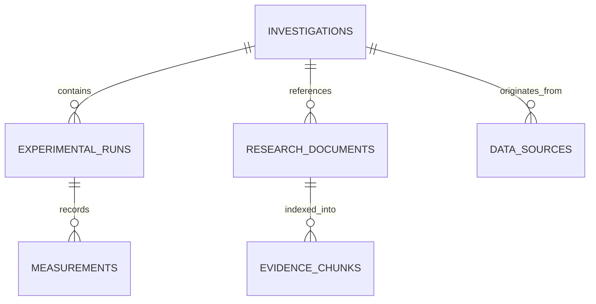

# Database Schema & Relational Models — FlameSafe AI

## 1. Overview & Technology Stack
FlameSafe AI utilizes **PostgreSQL 16** with the **pgvector** extension. All primary keys use UUID strings (stored as `VARCHAR(36)`) internally for uniform distributed uniqueness, while preserving official NASA Physical Sciences Informatics identifiers (`psi_id`) as indexed external keys.

---

## 2. Entity Relationship Diagram (ERD)



---

## 3. Relational Table Definitions

### Table: `investigations`
Represents top-level NASA microgravity flight combustion programs.

| Column | Type | Constraints | Description |
| :--- | :--- | :--- | :--- |
| `id` | `VARCHAR(36)` | PRIMARY KEY | Internal UUID |
| `psi_id` | `VARCHAR(64)` | UNIQUE, NOT NULL, INDEX | Official NASA PSI identifier (e.g. `PSI-BASS-01`) |
| `acronym` | `VARCHAR(32)` | NOT NULL, INDEX | Program acronym (e.g. `BASS`, `SAFFIRE`) |
| `title` | `VARCHAR(255)` | NOT NULL | Complete program title |
| `research_area`| `VARCHAR(128)` | NOT NULL, INDEX | Scientific combustion domain |
| `objectives` | `TEXT` | NULLABLE | Documented scientific goals |
| `description` | `TEXT` | NULLABLE | Narrative summary of flight experiments |
| `doi` | `VARCHAR(128)` | NULLABLE | Program-level Digital Object Identifier |
| `source_url` | `VARCHAR(512)` | NULLABLE | Primary URL to public archive |
| `metadata_payload` | `JSON` | NULLABLE | Target environments, flight facilities, PI names |
| `created_at` | `TIMESTAMPTZ` | NOT NULL, DEFAULT NOW | Record creation timestamp |
| `updated_at` | `TIMESTAMPTZ` | NOT NULL, DEFAULT NOW | Last updated timestamp |

---

### Table: `experimental_runs`
Represents discrete experimental runs, sample geometries, and environmental chamber settings.

| Column | Type | Constraints | Description |
| :--- | :--- | :--- | :--- |
| `id` | `VARCHAR(36)` | PRIMARY KEY | Internal UUID |
| `investigation_id` | `VARCHAR(36)` | FK -> `investigations.id` | Foreign key with CASCADE deletion |
| `run_code` | `VARCHAR(64)` | NOT NULL, INDEX | Test run code (e.g. `BASS-PMMA-FLAT-01`) |
| `fuel_type` | `VARCHAR(64)` | NOT NULL, INDEX | Fuel category (Solid Polymer, Fabric, etc.) |
| `fuel_name` | `VARCHAR(128)` | NOT NULL | Specific chemical or commercial name |
| `fuel_geometry`| `VARCHAR(128)` | NULLABLE | Dimensions, thickness, or droplet diameter |
| `gravity_regime`| `VARCHAR(64)`| NOT NULL, INDEX | `Microgravity`, `Lunar`, `Martian`, `1g` |
| `oxygen_concentration` | `FLOAT` | NULLABLE | Ambient volume percentage ($0.0 - 100.0$) |
| `pressure_value` | `FLOAT` | NULLABLE | Chamber atmospheric pressure |
| `pressure_unit` | `VARCHAR(16)`| DEFAULT 'kPa' | Standardized pressure unit |
| `airflow_velocity` | `FLOAT` | NULLABLE | Forced or induced flow velocity |
| `airflow_unit` | `VARCHAR(16)` | DEFAULT 'cm/s' | Standardized velocity unit |
| `suppressant` | `VARCHAR(128)` | NULLABLE | Gaseous quench agent ($N_2$, $CO_2$) |
| `sensor_types` | `JSON` | NULLABLE | Array of sensor names (radiometers, pyrometers) |
| `experimental_notes` | `TEXT` | NULLABLE | Observations regarding extinction or flame spread |

---

### Table: `measurements`
Represents quantitative physical measurements extracted from sensor telemetry and papers.

| Column | Type | Constraints | Description |
| :--- | :--- | :--- | :--- |
| `id` | `VARCHAR(36)` | PRIMARY KEY | Internal UUID |
| `run_id` | `VARCHAR(36)` | FK -> `experimental_runs.id` | Foreign key with CASCADE deletion |
| `metric_name` | `VARCHAR(128)` | NOT NULL, INDEX | Metric name (e.g. `Flame Spread Rate`) |
| `metric_value`| `FLOAT` | NULLABLE | Recorded value (preserved as `null` if unmeasured) |
| `unit` | `VARCHAR(32)` | NOT NULL | Explicit unit string (e.g. `cm/s`, `kW/m2`, `mm`) |
| `measurement_time` | `FLOAT`| NULLABLE | Elapsed test time in seconds |
| `source_document_id` | `VARCHAR(36)` | NULLABLE | Reference to source paper |

---

### Table: `research_documents`
Represents peer-reviewed journal papers and NASA Technical Reports Server documents.

| Column | Type | Constraints | Description |
| :--- | :--- | :--- | :--- |
| `id` | `VARCHAR(36)` | PRIMARY KEY | Internal UUID |
| `investigation_id` | `VARCHAR(36)` | FK -> `investigations.id` | Foreign key with CASCADE deletion |
| `title` | `VARCHAR(255)` | NOT NULL | Publication title |
| `document_type` | `VARCHAR(64)` | NOT NULL | `Journal Article`, `Conference Paper`, `Tech Report` |
| `doi` | `VARCHAR(128)` | NULLABLE | Digital Object Identifier |
| `source_url` | `VARCHAR(512)` | NULLABLE | Publication access link |
| `file_path` | `VARCHAR(512)` | NULLABLE | Local storage path |

---

### Table: `evidence_chunks`
Represents paragraph-level text segments prepared for semantic vector retrieval.

| Column | Type | Constraints | Description |
| :--- | :--- | :--- | :--- |
| `id` | `VARCHAR(36)` | PRIMARY KEY | Internal UUID |
| `document_id` | `VARCHAR(36)` | FK -> `research_documents.id` | Foreign key with CASCADE deletion |
| `chunk_text` | `TEXT` | NOT NULL | Extracted text paragraph |
| `page_number` | `INTEGER` | NULLABLE | Original PDF page number |
| `section_name`| `VARCHAR(128)` | NULLABLE | Section header (e.g. `Results & Discussion`) |
| `embedding` | `JSON` / `vector(768)` | NULLABLE | 768-dimensional embedding vector |
| `metadata_payload` | `JSON` | NULLABLE | Parameter tags and keywords |

---

### Table: `data_sources`
Tracks external data provenance and audit timestamps.

| Column | Type | Constraints | Description |
| :--- | :--- | :--- | :--- |
| `id` | `VARCHAR(36)` | PRIMARY KEY | Internal UUID |
| `investigation_id` | `VARCHAR(36)` | FK -> `investigations.id` | Foreign key with CASCADE deletion |
| `source_name` | `VARCHAR(128)` | NOT NULL | Archive name (`NASA PSI`, `NTRS`) |
| `source_url` | `VARCHAR(512)` | NOT NULL | Public source URL |
| `doi` | `VARCHAR(128)` | NULLABLE | Archive catalog DOI |
| `version` | `VARCHAR(32)` | DEFAULT '1.0' | Ingestion schema version |
| `accessed_at` | `TIMESTAMPTZ` | NULLABLE | Date/time accessed |

---

## 4. Alembic Migrations
Migrations are maintained in `backend/migrations/versions/`.
To apply migrations against a live database:
```bash
cd backend
alembic upgrade head
```
To generate a new migration revision:
```bash
alembic revision --autogenerate -m "describe_schema_change"
```
