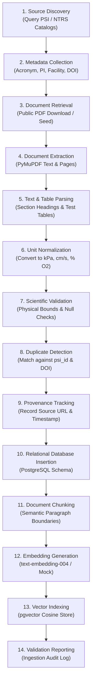

# Scientific Data Ingestion Architecture — FlameSafe AI

## 1. Overview & Data Sources
FlameSafe AI extracts, parses, normalizes, and indexes NASA microgravity combustion research from public scientific archives:
- **Primary Source**: NASA Physical Sciences Informatics (PSI) Repository ([https://psi.nasa.gov/physci/repo](https://psi.nasa.gov/physci/repo)).
- **Secondary Research Sources**: NASA Technical Reports Server (NTRS) ([https://ntrs.nasa.gov/](https://ntrs.nasa.gov/)) and NASA PSI Investigations by Research Area.

---

## 2. Ingestion Pipeline Stages



---

## 3. Core Software Components in Ingestion

### 3.1. `PSISourceAdapter` (`app/ingestion/sources/psi_adapter.py`)
Responsible for reading raw metadata JSON payloads or querying public endpoints, extracting canonical NASA program metadata, and passing records to the parser.

### 3.2. `PDFExtractor` (`app/ingestion/extractors/pdf_extractor.py`)
Utilizes PyMuPDF (`fitz`) to extract clean text blocks, identify page boundaries, and isolate publication sections without stripping superscript/subscript chemical notations ($O_2$, $CO_2$, $CH_4$).

### 3.3. `UnitNormalizer` (`app/ingestion/normalizers/unit_normalizer.py`)
Converts pressure values to kilopascals (kPa), airflow velocities to centimeters per second (cm/s), and oxygen fractions to percentages (0-100%). Preserves the original raw numerical value and unit alongside the normalized version.

### 3.4. `ScientificValidator` (`app/ingestion/validators/scientific_validator.py`)
Enforces scientific sanity bounds:
- Verifies that oxygen fraction is between 0% and 100%.
- Confirms pressure and airflow velocity are non-negative.
- Ensures missing measurements remain `null` and are not coerced to zero.
- Validates DOI string format against standard DOI regex (`10.xxxx/...`).

---

## 4. Guide for Adding New NASA Investigations

To add a new NASA flight investigation (e.g. from a newly published PSI dataset):

1. **Create Seed JSON Record**:
   Add an entry into `data/seed/seed_investigations.json` conforming to `InvestigationDetailSchema`:
   ```json
   {
     "id": "new-uuid-here",
     "psi_id": "PSI-YOUR-INVESTIGATION-ID",
     "acronym": "NEW_PROG",
     "title": "Full Official Title",
     "research_area": "Solid Fuel Flammability & Suppression",
     "objectives": "Scientific research goals...",
     "description": "Experimental narrative...",
     "doi": "10.xxxx/yyyyy",
     "source_url": "https://psi.nasa.gov/physci/repo",
     "experimental_runs": [ ... ],
     "research_documents": [ ... ],
     "data_sources": [ ... ]
   }
   ```
2. **Add Document Chunks**:
   Add corresponding publication chunks to `data/seed/seed_documents.json` with page numbers and section headers.
3. **Run Seeding Script**:
   ```bash
   cd backend
   python -m scripts.seed_data
   ```
4. **Validate Ingestion**:
   Run the automated test suite to verify that the new program is indexed:
   ```bash
   python -m pytest app/tests/test_investigations.py
   ```
