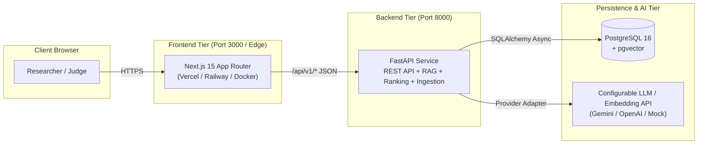

# Deployment & Infrastructure Plan — FlameSafe AI

## 1. Deployment Architecture Overview

FlameSafe AI uses a **Modular Monolith** architecture designed to deploy cleanly in three tiers depending on team stage:



### Supported Deployment Topologies

| Topology | Target Use Case | Frontend Host | Backend Host | Database Host | Cost / Complexity |
| :--- | :--- | :--- | :--- | :--- | :--- |
| **Option A: Local / Demo Docker Stack** | Hackathon live demo, offline judging, local QA | Docker (`frontend:3000`) | Docker (`backend:8000`) | Docker (`pgvector/pgvector:pg16`) | Free / 1 command |
| **Option B: Managed Cloud PaaS (Recommended)** | Public live URL for NASA Space Apps judges | **Vercel** (or Railway) | **Railway** or **Render** | **Neon** or **Supabase** (PostgreSQL 16 + `pgvector`) | Free-tier friendly / Zero ops |
| **Option C: Single Cloud VM** | Full container control on a single VPS | Docker Compose + Caddy/Nginx TLS | Docker Compose | Docker Compose persistent volume | $5–$10/mo VPS |

---

## 2. Phase-by-Phase Deployment Plan

### Phase 1: Pre-Deployment Verification (Local Gate)
Before deploying to any remote environment, both developers must verify that all checks pass on the `integration` branch before merging to `main`:

```powershell
# 1. Backend test suite (11/11 tests)
cd backend
python -m pytest -v

# 2. Frontend TypeScript & unit tests
cd ../frontend
npx tsc --noEmit
node --test tests/formatters.test.js
```

---

### Phase 2: Database Provisioning (PostgreSQL 16 + `pgvector`)

#### Using Managed PostgreSQL (Neon / Supabase / Railway Postgres)
1. Provision a PostgreSQL 16 instance.
2. Enable the `vector` extension in SQL Editor or via migration:
   ```sql
   CREATE EXTENSION IF NOT EXISTS vector;
   ```
3. Copy the connection string and format it using the async driver scheme:
   ```text
   postgresql+asyncpg://<user>:<password>@<host>:5432/<database>
   ```
4. Run schema migrations and seed the canonical NASA investigations (BASS, SAFFIRE, FLEX, SAME, ACME):
   ```bash
   cd backend
   python scripts/run_migrations.py
   ```
   *(Note: On startup, `app/main.py` also verifies schemas and automatically seeds the 5 canonical NASA investigations if the database is empty.)*

---

### Phase 3: Backend Service Deployment (`backend/`)

#### Deploying to Railway / Render / Cloud Run
1. **Root Directory**: Set service root directory to `backend` (or use `backend/Dockerfile`).
2. **Build & Start Commands**:
   - **Dockerfile path**: `backend/Dockerfile`
   - **Start command**:
     ```bash
     uvicorn app.main:app --host 0.0.0.0 --port ${PORT:-8000} --workers 2
     ```
3. **Health Check Path**: `/api/v1/health` (expects HTTP `200 OK`).
4. **Backend Environment Variables**:

| Variable | Production Value | Required | Purpose |
| :--- | :--- | :--- | :--- |
| `ENVIRONMENT` | `production` | Yes | Disables debug stack traces |
| `DEBUG` | `false` | Yes | Production logging mode |
| `DATABASE_URL` | `postgresql+asyncpg://...` | Yes | Async PostgreSQL connection |
| `USE_SQLITE_FALLBACK` | `false` | Yes | Enforces PostgreSQL in production |
| `ALLOWED_ORIGINS` | `["https://flamesafe-ai.vercel.app"]` | Yes | Strict CORS origin allowlist |
| `AI_PROVIDER` | `gemini` (or `mock` for deterministic demo) | Yes | Selects LLM synthesis adapter |
| `EMBEDDING_PROVIDER` | `gemini` (or `mock` for deterministic demo) | Yes | Selects embedding adapter |
| `GEMINI_API_KEY` | `<your-api-key>` | If `gemini` | Google AI Studio API key |

---

### Phase 4: Frontend Service Deployment (`frontend/`)

#### Deploying to Vercel / Netlify / Railway
1. **Root Directory**: Set to `frontend`.
2. **Framework Preset**: Next.js.
3. **Install Command**: `npm install --legacy-peer-deps`
4. **Build Command**: `npm run build`
5. **Frontend Environment Variables**:

| Variable | Production Value | Required | Purpose |
| :--- | :--- | :--- | :--- |
| `NEXT_PUBLIC_API_BASE_URL` | `https://<backend-domain>/api/v1` | Yes | Points client & server fetches to deployed FastAPI backend |
| `NEXT_PUBLIC_APP_ENV` | `production` | Optional | Environment indicator badge |

---

### Phase 5: Single-Command Docker Compose Deployment (Self-Hosted / Demo Machine)

For deploying the entire stack on a single cloud VM (Ubuntu 22.04/24.04) or local demonstration workstation:

```bash
# 1. Clone repository and checkout main
git clone https://github.com/GhariebML/FLAMESAFE-AI.git
cd FLAMESAFE-AI

# 2. Configure environment variables
cp .env.example .env
# Edit .env with production secrets if using external LLM provider

# 3. Build and start all 3 containers (db, backend, frontend)
docker compose up --build -d

# 4. Inspect service health
docker compose ps
docker compose logs -f backend
```

#### Container Topology in `docker-compose.yml`
- **`db`**: `pgvector/pgvector:pg16` on port `5432`, backed by persistent volume `postgres_data`, health-checked via `pg_isready`.
- **`backend`**: FastAPI on port `8000`, waits for `db` health check, mounts `./data` read-only for initial NASA seed records.
- **`frontend`**: Next.js on port `3000`, connects to `backend:8000`.

---

## 3. Post-Deployment Smoke Test Checklist

Run the following verification checks immediately after deploying:

```powershell
# 1. Verify API Health & Database Connectivity
Invoke-RestMethod -Uri "https://<backend-host>/api/v1/health"

# 2. Verify Mission Overview Aggregations
Invoke-RestMethod -Uri "https://<backend-host>/api/v1/overview"

# 3. Verify Seeded NASA Investigations (BASS, SAFFIRE, FLEX, SAME, ACME)
Invoke-RestMethod -Uri "https://<backend-host>/api/v1/investigations"

# 4. Verify OpenAPI Documentation UI
# Open https://<backend-host>/docs in browser
```

### Functional UI Verification
1. **`/dashboard`** — Confirm 5 NASA investigations, experimental runs, and evidence chunk counts render.
2. **`/investigations`** — Filter by `Microgravity` or `Spacecraft` and open a detail view.
3. **`/compare`** — Compare `NASA-PSI-BASS-001` vs `NASA-PSI-SAFFIRE-001` and confirm parameter delta table renders (`null` values preserved as `Not Reported`).
4. **`/insights`** — Run relevance ranking and verify factor breakdown ($R = 0.30D + 0.25F + 0.20C + 0.15M + 0.10Q$) and non-probabilistic disclaimer appear.
5. **`/scenarios`** — Test Lunar Habitat ($0.166g$) or ISS ($0g$) regime and confirm gap analysis advisory renders.
6. **`/assistant`** — Submit a query and confirm grounded citations with DOI and page numbers are returned.

---

## 4. Rollback & Recovery Strategy

1. **Application Rollback**:
   - **Cloud PaaS (Vercel / Railway / Render)**: Instant 1-click rollback to the previous immutable deployment commit on `main`.
   - **Docker Compose**: `git checkout <previous-tag> && docker compose up --build -d`.
2. **Database Migration Rollback**:
   ```bash
   cd backend
   alembic downgrade -1
   ```
3. **Deterministic Demo Fallback**:
   - If an external LLM API experiences rate-limiting or outage during live judging, set `AI_PROVIDER=mock` and `EMBEDDING_PROVIDER=mock`. The backend immediately falls back to deterministic grounded synthesis using the verified NASA evidence chunks with zero downtime.
