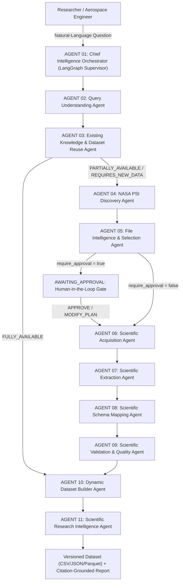

# FlameSafe AI — 11-Agent Autonomous Scientific Data Intelligence Architecture

## 1. Architectural Vision

FlameSafe AI extends its verified FastAPI + Next.js 15 + SQLAlchemy 2.0 modular monolith with a **Supervisor-Led, State-Driven Multi-Agent System** built on `langgraph.graph.StateGraph`.

Instead of using unconstrained, free-form LLM loops, FlameSafe AI separates **probabilistic scientific synthesis** from **deterministic scientific validation**. Every agent operates on a typed `ResearchWorkflowState`, logs its execution to `agent_runs` and `workflow_events`, and writes durable state snapshots to `agent_checkpoints`.

---

## 2. The 11 Logical Agents & Boundaries

| Agent ID | Agent Name | Core Responsibility | Deterministic vs. AI Boundary |
|---|---|---|---|
| **AGENT 01** | Chief Intelligence Orchestrator | Compiles and routes the `StateGraph`, enforces conditional transitions, manages `AWAITING_APPROVAL` pauses, and writes `AgentRun`, `WorkflowEvent`, and `AgentCheckpoint` rows. | Deterministic state machine (`backend/app/agents/orchestrator/supervisor.py`). |
| **AGENT 02** | Query Understanding Agent | Decomposes natural-language questions into structured `ResearchIntentSchema` (`intent_type`, `research_domain`, `fuel_type`, `gravity_regime`, `target_investigations`, `variables_of_interest`). | Rule-augmented entity parser with researcher-editable override (`POST /research/requests/{id}/revise`). |
| **AGENT 03** | Existing Knowledge & Dataset Reuse Agent | Queries local `investigations`, `research_documents`, `evidence_chunks`, and `datasets` to classify coverage (`FULLY_AVAILABLE`, `PARTIALLY_AVAILABLE`, `REQUIRES_NEW_DATA`). | Deterministic SQLAlchemy repository check; skips redundant external downloads when local verified datasets already match. |
| **AGENT 04** | NASA PSI Discovery Agent | Searches the 11-campaign NASA Physical Sciences Informatics catalog (`BASS`, `BASS-II`, `SAFFIRE`, `FLEX`, `FLEX-2`, `SAME`, `SAME-R`, `ACME`, `CFI-G`, `SOFIE`, `BRE`). | Grounded catalog lookup (`PSIDiscoveryService`); never fabricates DOIs or unverified NASA URLs. |
| **AGENT 05** | File Intelligence & Selection Agent | Scores file manifests using $F = 0.35Q + 0.25T + 0.20C + 0.10P + 0.10A$ and excludes bulky raw video archives (`>25 MB`) unless explicitly requested. | Deterministic multi-factor mathematical formula (`PSIFileManifestService`). |
| **AGENT 06** | Scientific Acquisition Agent | Acquires selected files via `seed://` verified local assets or generates structured `USER_HANDOFF_REQUIRED` instructions for restricted NASA PSI portal archives. | Enforces HTTPS allowlist, SSRF IP blocking, path traversal sanitization, and SHA-256 vault deduplication. |
| **AGENT 07** | Scientific Extraction Agent | Extracts experimental runs, environmental conditions, and measurements from relational tables and acquired JSON/CSV seed files. | Deterministic parser (`DynamicDatasetEngine.extract_from_database_and_assets`). |
| **AGENT 08** | Scientific Schema Mapping Agent | Maps heterogeneous records into the canonical FlameSafe schema and normalizes units via `UnitNormalizer` while strictly preserving `null` values (`null` is never converted to `0`). | Deterministic unit conversion and schema mapping. |
| **AGENT 09** | Scientific Validation & Quality Agent | Validates physical bounds ($0 \le \text{O}_2 \le 100\%$, $0 \le P \le 500\text{ kPa}$), unit presence, duplicate signatures, and DOI format. | 100% deterministic rule engine (`PASSED`, `PASSED_WITH_WARNINGS`, `NEEDS_HUMAN_REVIEW`, `REJECTED`). |
| **AGENT 10** | Dynamic Dataset Builder Agent | Computes SHA-256 `content_fingerprint`, reuses identical versions or increments `v1.0.0` $\to$ `v2.0.0`, and writes `JSON`, `CSV`, and `Parquet` exports to `StorageVaultService`. | Deterministic cryptographic fingerprinting and multi-format serialization. |
| **AGENT 11** | Scientific Research Intelligence Agent | Synthesizes the final scientific answer using the constructed dataset and `AIService` RAG pipeline (`EvidenceRetriever`, `ScientificReranker`, `CitationValidator`). | Grounded RAG synthesis with explicit provider metadata and mandatory citations. |
