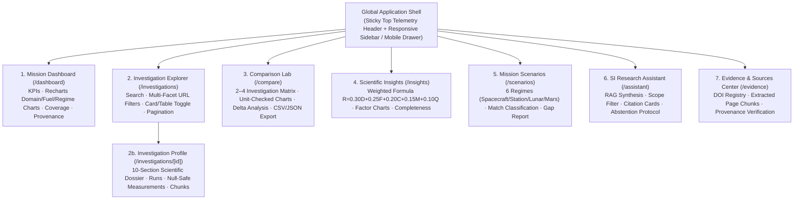

# FlameSafe AI — Product Strategy & Aerospace Design System Direction

## 1. Product Positioning

**FlameSafe AI** is an **Aerospace Scientific Research & Fire Safety Intelligence Platform** built for the 2026 NASA Space Apps Challenge ("Flame in Freefall: SI-Powered Fire Safety Insights from Microgravity Combustion Data").

- **Core Tagline:** *"Turning Microgravity Combustion Research into Intelligent Fire Safety Insights."*
- **Category:** AI-Powered Scientific Intelligence & Mission Safety Decision-Support Platform.
- **Positioning Statement:** For combustion scientists, spacecraft fire-safety engineers, and mission planners who need to synthesize fragmented microgravity flight experiments (`BASS`, `SAFFIRE`, `FLEX`, `SAME`, `ACME`), FlameSafe AI provides an evidence-grounded analytical workspace that unifies experimental telemetry, multi-investigation comparison, transparent relevance ranking, partial-gravity gap analysis, and DOI-verified literature synthesis.
- **Non-Endorsement & Scientific Integrity Mandate:** FlameSafe AI is an independent hackathon engineering platform developed by Team R². It does not claim NASA endorsement or certification, never fabricates experimental measurements or DOIs, never coerces missing (`null`) measurements to zero, and never presents research relevance scores ($R$) as probabilistic fire-risk predictions.

---

## 2. Target Audiences & User Personas

| Persona | Role & Context | Primary Goals | Key Pain Points Addressed |
| :--- | :--- | :--- | :--- |
| **Dr. Elena Vance — Microgravity Combustion Scientist** | Principal Investigator analyzing ISS glovebox (`MSG`) and rack (`CIR`) experiments | Compare quench limits, limiting oxygen concentrations (`LOC`), and flame spread rates across fuel geometries | Experimental data is scattered across separate PSI datasets and multi-page PDF papers with inconsistent units (`atm`, `psi`, `kPa`, `mm/s`, `cm/s`) |
| **Marcus Chen — Spacecraft & Habitat Fire Safety Engineer** | ECLSS & Cabin Safety Lead designing Artemis Lunar Habitat ($0.166g$) and transit vehicles | Identify whether $0g$ orbital data covers proposed exploration atmospheres ($28\text{–}34\%\ \text{O}_2$ at $56\text{–}70\ \text{kPa}$) | Terrestrial $1g$ upward flammability tests (`NASA-STD-6001`) are non-conservative in low-velocity forced ventilation; engineers need clear extrapolation & gap reports |
| **Sara Al-Mansoor — Aerospace Graduate Researcher** | Literature reviewer studying smoke aerosol morphology and cool-flame kinetics | Ask natural-language questions and trace every claim to an exact DOI, page number, and experimental run | Generic LLMs hallucinate citations and conflate $1g$, $0g$, and partial-gravity combustion physics |

---

## 3. Core User Journeys

1. **Workflow A — Discovery to Deep Inspection**:
   `Mission Dashboard (/dashboard)` $\rightarrow$ Inspect domain & fuel distributions $\rightarrow$ `Investigation Explorer (/investigations)` with URL-persisted filters (`fuel_type`, `gravity_regime`, `research_area`) $\rightarrow$ `Investigation Detail (/investigations/[id])` inspecting runs, null-safe measurements, sensors, and evidence chunks.
2. **Workflow B — Multi-Investigation Comparative Analysis**:
   `Comparison Lab (/compare)` $\rightarrow$ Select 2–4 NASA investigations $\rightarrow$ Inspect normalized parameter matrix, unit-compatible quantitative `BarChart` (`% O2`, `kPa`, `cm/s`), and `RadarChart` coverage profile $\rightarrow$ Export structured `CSV` / `JSON` report.
3. **Workflow C — Exploration Mission Scenario & Gap Evaluation**:
   `Scenario Analyzer (/scenarios)` $\rightarrow$ Select target regime (`Spacecraft`, `Space Station`, `Lunar Habitat`, `Lunar Rover`, `Mars Habitat`, `Mars Rover`) & environmental parameters $\rightarrow$ Review classified matches (`Exact Match`, `Partial Match`, `Extrapolated Regime`, `Unsupported Condition`), empirical evidence, and research gaps.
4. **Workflow D — Evidence-Grounded Research Synthesis**:
   `SI Research Assistant (/assistant)` $\rightarrow$ Select optional investigation scope $\rightarrow$ Ask technical query $\rightarrow$ Review grounded response with explicit AI Provider Mode badge, uncertainty notes, and clickable DOI/page citations $\rightarrow$ Cross-verify in `Evidence Center (/evidence)`.

---

## 4. Information Architecture & Page Hierarchy

---

## 5. Visual Identity & Color System

FlameSafe AI uses the visual language of **aerospace mission control panels and precision scientific laboratories**—high-contrast dark telemetry surfaces with restrained semantic accents.

### Official Color Tokens

| Token Role | Name | Hex Code | Tailwind Class / Usage |
| :--- | :--- | :--- | :--- |
| **Primary Background** | Deep Space Navy | `#071525` | `bg-space-950` — Root application canvas |
| **Secondary Background** | Midnight Blue | `#0D2035` | `bg-space-900` — Cards, sidebar, elevated panels |
| **Tertiary Surface / Border** | Orbital Slate | `#152C47` / `#1E3A5F` | `bg-space-800` / `border-space-800` — Borders, table headers, inputs |
| **Primary Accent** | Electric Blue | `#3B82F6` | `blue-500` — Primary interactive controls, active focus rings |
| **Secondary Accent** | Scientific Cyan | `#22D3EE` | `plasma-400` — Telemetry badges, DOI links, vector/RAG indicators |
| **Combustion Accent** | Controlled Amber | `#F59E0B` | `amber-500` — Combustion metrics, relevance highlights, caution states |
| **Warning / Flame Accent** | Coral / Orange | `#F97316` | `flame-500` — Flame spread indicators, extrapolation warnings |
| **Verified / Exact Match** | Telemetry Emerald | `#10B981` | `emerald-500` — Direct empirical match, online API health, verified DOI |
| **Primary Text** | Slate White | `#F8FAFC` | `text-slate-50` — Headings, primary numerical readouts |
| **Secondary Text** | Muted Slate | `#94A3B8` | `text-slate-400` — Labels, units, metadata captions |

---

## 6. Typography & Information Density

- **Primary UI Font**: Inter / system sans-serif (`font-sans`) for crisp legibility across dense tables and analytical summaries.
- **Technical & Telemetry Font**: JetBrains Mono / system monospace (`font-mono`) for PSI IDs (`PSI-BASS-01`), run codes (`SAFFIRE-I-COTTON-01`), DOIs, physical units (`kPa`, `cm/s`, `% O2`), and relevance scores.
- **Hierarchy Scale**:
  - Page Title: `text-xl sm:text-2xl font-bold tracking-tight text-slate-50`
  - Section Header: `text-sm font-semibold uppercase tracking-wider text-slate-300`
  - Metric Value: `text-2xl sm:text-3xl font-mono font-bold text-white`
  - Body / Evidence Excerpt: `text-xs sm:text-sm leading-relaxed text-slate-300`
  - Metadata / Unit Label: `text-[11px] font-mono text-slate-400`

---

## 7. Responsive Strategy & Mobile First-Class Support

Target viewports: **`360px`**, **`390px`**, **`768px`**, **`1024px`**, **`1440px`**, and **`1920px`**.

1. **Navigation**:
   - `< 768px`: Compact top header with hamburger toggle opening an accessible slide-over **Mobile Navigation Drawer** with full module links, quick search, and API status.
   - `>= 768px`: Persistent 256px left navigation sidebar with grouped scientific modules.
2. **Charts & Visualizations**:
   - Every Recharts visualization is wrapped in `ResponsiveContainer` inside `ChartContainer` with adaptive margins and legend placement.
3. **Tables & Comparison Matrices**:
   - Wrapped in overflow-x scroll containers with sticky first columns on narrow screens so zero page-level horizontal overflow occurs at `360px`.
4. **Touch Targets**:
   - Interactive controls maintain a minimum height of `36px–40px` on mobile with clear focus and active states.

---

## 8. Accessibility Standards (WCAG 2.2 AA)

- **Keyboard Navigation**: All interactive controls, tabs, drawers, and filter pills are reachable via `Tab` / `Shift+Tab` and operable via `Enter` / `Space` / `Escape`.
- **Visible Focus Indicators**: Consistent `focus-visible:outline-none focus-visible:ring-2 focus-visible:ring-blue-500/80` across all inputs and buttons.
- **Color Contrast**: Primary text (`#F8FAFC`) and secondary text (`#94A3B8`) against `#071525` and `#0D2035` exceed WCAG AA 4.5:1 contrast ratios. Status badges pair color with explicit text labels and icons (never relying on color alone).
- **Reduced Motion**: Respects `prefers-reduced-motion: reduce` in CSS.

---

## 9. Design Acceptance Criteria

- [x] Cohesive Deep Space Navy (`#071525`) and Midnight Blue (`#0D2035`) visual identity applied across all routes.
- [x] Responsive application shell with desktop sidebar, mobile slide-over drawer, breadcrumbs, and live API/AI mode status indicator.
- [x] Interactive Recharts visualizations with titles, descriptions, physical units, tooltips, loading skeletons, and empty states.
- [x] Null-safe scientific formatting (`Not recorded` badge instead of `0` for `null` values).
- [x] Explicit distinction between live AI provider responses and deterministic offline demo/mock mode.
