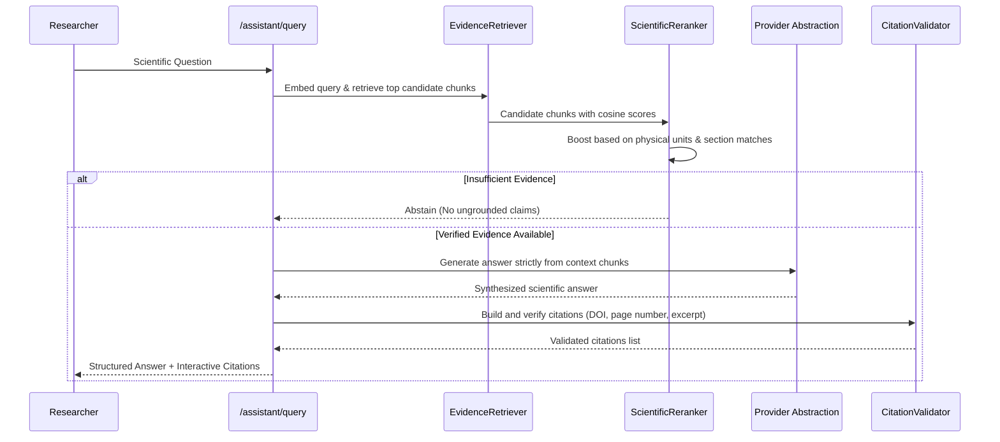

# Scientific Intelligence Engine & RAG Architecture — FlameSafe AI

## 1. Scientific Relevance Ranking Engine (Module 4)

### The 5-Factor Weighted Scoring Model
To match vast archives of combustion research to a specific space mission safety inquiry, FlameSafe AI implements a configurable multi-factor weighted scoring model:

$$R = 0.30 D + 0.25 F + 0.20 C + 0.15 M + 0.10 Q$$

Where every component factor is normalized between $0$ and $100$:
- **$D$ — Research Domain Relevance (30%)**: Matches inquiry terminology against official research area taxonomy, investigation title, and documented objectives.
- **$F$ — Fuel Type Compatibility (25%)**: Evaluates compatibility between requested material (e.g. solid PMMA, Nomex fabric, n-heptane droplet) and the fuel samples tested in documented experimental runs.
- **$C$ — Experimental Conditions Compatibility (20%)**: Assesses the completeness and alignment of environmental variables (chamber pressure, forced ventilation airflow, oxygen fraction).
- **$M$ — Mission Applicability (15%)**: Measures relevance to specific exploration operational environments (Spacecraft cabin, Lunar surface habitat, Martian outpost).
- **$Q$ — Evidence & Metadata Quality (10%)**: Evaluates completeness of documentation, presence of peer-reviewed DOIs, and official NASA PSI registry validation.

> [!IMPORTANT]
> **Scientific Ranking Disclaimer**:
> This weighted relevance score ($R$) represents an academic and informational research alignment index. It **DOES NOT** represent a physical fire-risk probability, flammability hazard index, or NASA-certified safety clearance.

---

## 2. Retrieval-Augmented Generation (RAG) Pipeline (Module 6)

### Complete RAG Workflow

---

## 3. RAG Pipeline Components

### 3.1. Chunking Strategy (`ScientificTextChunker`)
- **Target Size**: 500 words with 50-word overlap.
- **Boundary Preservation**: Splits along paragraph boundaries and document section headers (`Results & Discussion`, `Experimental Procedure`) rather than naive character slicing, preventing broken chemical formulas and fragmented measurement tables.

### 3.2. Embedding Provider Abstraction (`BaseEmbeddingProvider`)
- **Configurable Models**:
  - `gemini`: Uses Google Gemini `text-embedding-004` (768 dimensions).
  - `openai`: Uses `text-embedding-3-small` (1536 dimensions).
  - `mock`: Generates deterministic normalized hash vectors for offline local execution and CI testing without requiring API keys.

### 3.3. Evidence Retriever (`EvidenceRetriever`)
Computes cosine similarity between the query embedding vector and stored chunk embeddings:
$$\text{Sim}(\vec{u}, \vec{v}) = \frac{\vec{u} \cdot \vec{v}}{\|\vec{u}\| \|\vec{v}\|}$$
Applies metadata filters (such as restricting retrieval to a specific `investigation_id`) when requested by the user.

### 3.4. Scientific Reranker (`ScientificReranker`)
Enhances pure vector similarity by boosting chunks that contain explicit quantitative measurements (e.g. `cm/s`, `kPa`, `% O2`, `kW/m2`) and exact keyword matches in section headings.

### 3.5. LLM Answer Generation (`BaseLLMProvider`)
- System prompt strictly instructs the model:
  1. Rely exclusively on the provided context chunks.
  2. Do not extrapolate beyond documented microgravity experimental conditions.
  3. Clearly state uncertainty when experimental runs do not directly match partial-gravity conditions (Moon/Mars).

### 3.6. Citation Verification (`CitationValidator`)
Constructs verifiable citations:
- Citation ID (`CIT-001`)
- Investigation Acronym (`BASS`, `SAFFIRE`)
- NASA PSI Identifier (`PSI-BASS-01`)
- Official Publication Title
- Digital Object Identifier (`DOI`)
- Publication Page Number & Section Name
- Verbatim Excerpt

---

## 4. Hallucination Prevention & Abstention Protocol
When retrieved document chunks fail to meet the similarity threshold ($\text{score} < 0.30$) or when no indexed document discusses the queried phenomenon, the system triggers the **Abstention Protocol**:
- The model does not attempt to improvise an answer.
- It returns an explicit response stating that insufficient verified NASA empirical evidence exists in the repository.
- It provides a scientific uncertainty note explaining why the query could not be reliably answered.
