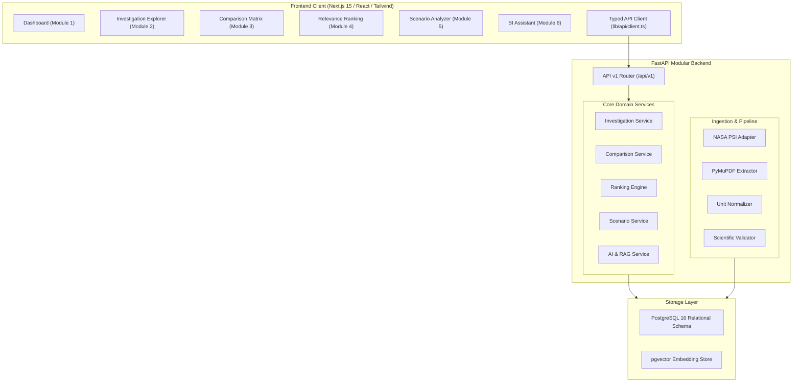

# System Architecture — FlameSafe AI

## 1. Architectural Topology: Modular Monolith
FlameSafe AI adopts a **Modular Monolith** architecture with an **API-First** integration pattern. This architecture balances high developer velocity with rigorous separation of concerns, eliminating the operational overhead of microservices while providing clean, decoupled boundaries between the user interface, backend services, and scientific data pipelines.

---

## 2. Frontend Layer (Next.js 15)
- **Framework**: Next.js 15 utilizing the App Router architecture.
- **Language**: TypeScript with strict mode enabled (`strict: true`).
- **Styling**: Tailwind CSS with custom space-themed design tokens (`space`, `flame`, `plasma`).
- **Data Visualization**: Recharts for parameter distributions and radar comparisons.
- **Client Architecture**:
  - `components/layout/`: Global layout components (`AppShell`, `Navbar`, `Sidebar`, `Footer`).
  - `components/shared/`: Accessible primitives (`Badge`, `Button`, `Card`, `LoadingSkeleton`, `EmptyState`, `ErrorBoundary`).
  - `components/[module]/`: Domain-specific presentational views.
  - `hooks/`: Custom state management hooks (`useInvestigations`, `useCompare`, `useScenario`, `useAssistant`, `useOverview`).
  - `lib/api/client.ts`: Centralized, typed API client wrapping standard `fetch` with error boundaries and data envelope unwrapping.

---

## 3. Backend Layer (FastAPI & Python 3.11+)
- **Framework**: FastAPI running on Uvicorn with asynchronous event loops.
- **Data Validation & Schemas**: Pydantic v2 schemas for request parsing, response formatting, and automatic OpenAPI 3.1 documentation generation.
- **ORM & Data Access**: SQLAlchemy 2.0 with asynchronous engine (`AsyncSession`), leveraging the Repository Pattern to abstract SQL query logic from business services.
- **Service Layer**:
  - `InvestigationService`: Metrics aggregation, multi-field filtering, and investigation profiles.
  - `ComparisonService`: Parameter matrix alignment, unit verification, and comparative summarization.
  - `RankingService`: Implementation of the 5-factor scientific relevance formula.
  - `ScenarioService`: Environmental regime cross-matching, analog mapping, and knowledge gap detection.
  - `AIService`: End-to-end RAG orchestrator coordinating retriever, reranker, LLM provider, and citation validator.

---

## 4. Database Layer (PostgreSQL 16 & pgvector)
- **Engine**: PostgreSQL 16.
- **Vector Search**: `pgvector` extension for storing and performing cosine distance queries on 768-dimensional text embeddings.
- **Schema Management**: Alembic database migrations tracking all relational schema revisions (`backend/migrations/`).
- **Fallback Capability**: Automatic dynamic fallback to SQLite (`aiosqlite`) during standalone local testing when PostgreSQL is unreachable.

---

## 5. Extensible AI & RAG Layer
The AI architecture abstracts LLM generation and embedding providers behind interfaces:
- `BaseLLMProvider`: Allows switching between `GeminiLLMProvider`, `OpenAILLMProvider`, and `MockLLMProvider`.
- `BaseEmbeddingProvider`: Allows switching between Google Gemini embeddings (`text-embedding-004`) and deterministic offline vectors.
- `CitationValidator`: Validates that generated statements reference authentic, indexed chunks, associating each claim with an investigation acronym, DOI, and page number.

---

## 6. End-to-End Request Lifecycle
1. **User Action**: The researcher interacts with a UI module (e.g. queries the SI Assistant).
2. **Client Dispatch**: `apiClient.queryAssistant()` formats the request into a JSON payload conforming to `AssistantQueryRequest`.
3. **Route Handling**: FastAPI `/api/v1/assistant/query` validates incoming data using Pydantic.
4. **Service Execution**: `AIService` retrieves candidate chunks from PostgreSQL/pgvector, executes cosine similarity ranking, reranks top chunks based on scientific terms, and calls the active LLM provider.
5. **Citation Verification**: `CitationValidator` constructs structured citations linking each claim to its authentic publication DOI and page number.
6. **Response Envelope**: The backend wraps the output in `APIResponseEnvelope[AssistantQueryResponse]` with a UTC timestamp.
7. **UI Rendering**: The frontend renders the synthesized response alongside interactive citation badges.
