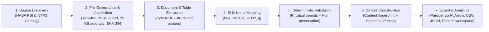

# Scientific Data Lifecycle

FlameSafe AI transforms heterogeneous NASA Physical Sciences Informatics (PSI) and NTRS publications into versioned, unit-consistent, provenance-tracked datasets.

## Scientific Data Integrity Policies

- **Null Preservation:** Missing experimental measurements remain `null` (`None` in Python) and are rendered as `"Not recorded"` in the UI—never interpolated or silently coerced to `0`.
- **Download Governance:** `FLAMESAFE_AUTO_ACQUISITION_MAX_BYTES` (default `25 MB`) caps automated in-app file downloads; files exceeding NASA PSI's 1 GB bulk threshold (`NASA_PSI_BULK_EMAIL_THRESHOLD_BYTES`) are flagged for NASA PSI's official email-prepared download workflow.
- **Lineage & Versioning:** Every `DatasetItem` links back to its source `ExperimentalRun`, `Investigation`, `ResearchDocument` DOI, page/section reference, and unit conversion formula.
