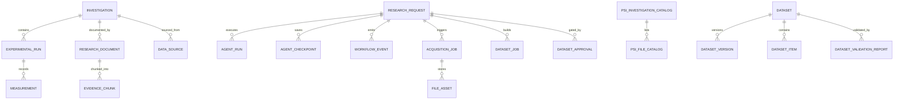

# Database Entity Relationship Diagram

Verified against SQLAlchemy models in `backend/app/models/`.

## Database Engines & Migrations

- **Production Target:** PostgreSQL 16 with `pgvector` (`Vector(768)` on `EvidenceChunk`).
- **Standalone / Local Fallback:** SQLite via `aiosqlite` when `USE_SQLITE_FALLBACK=true` and PostgreSQL is unreachable or `asyncpg` is absent.
- **Alembic Migrations (`backend/migrations/versions/`):**
  1. `001_initial_schema.py` — Core scientific tables (`investigations`, `experimental_runs`, `measurements`, `research_documents`, `evidence_chunks`, `data_sources`)
  2. `002_add_embedding_metadata.py` — Provider and dimension tracking on `evidence_chunks`
  3. `003_multi_agent_dataset_engine.py` — Multi-agent workflow, PSI catalog, vault, and dynamic dataset tables
  4. `004_update_embedding_dimension_768.py` — Aligns vector dimension to 768 for `gemini-embedding-2`
