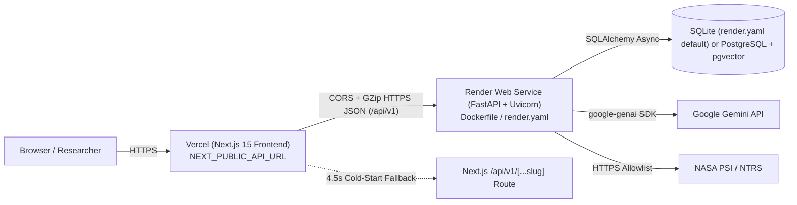

# Deployment Architecture

FlameSafe AI is configured for split cloud deployment (**Vercel** for Next.js frontend + **Render** for FastAPI backend) as well as full local containerized execution (**Docker Compose**).

## Environment Separation

| Environment | Frontend | Backend | Database | AI Provider |
| :--- | :--- | :--- | :--- | :--- |
| **Local Dev** | `npm run dev` (`localhost:3000`) | `uvicorn` (`localhost:8001` or `8000`) | SQLite fallback or local Postgres | `gemini` (if key set) or `mock` |
| **Docker Compose** | Container `flamesafe_frontend:3000` | Container `flamesafe_backend:8000` | `pgvector/pgvector:pg16` | Configurable via `.env` |
| **Cloud Production** | Vercel (`frontend/vercel.json`) | Render (`render.yaml` / `Dockerfile`) | SQLite (`flamesafe_prod.db`) or Managed Postgres | `gemini` (`GEMINI_API_KEY` secret) |
