# Multi-Agent Workflow Architecture

FlameSafe AI's research automation is coordinated by **AGENT 01 (`ChiefIntelligenceOrchestrator`)** using a compiled **LangGraph `StateGraph`** (`backend/app/agents/orchestrator/supervisor.py`) and node implementations (`backend/app/agents/nodes.py`). Every step persists `AgentRun`, `WorkflowEvent`, and `AgentCheckpoint` rows to the database for full auditability and resumability.

```mermaid
flowchart TD
    START(["User Research Question (/research)"]) --> A02["AGENT_02: Query Understanding Agent<br/>(Intent, fuel, gravity & variable decomposition)"]
    A02 --> A03["AGENT_03: Existing Knowledge & Reuse Agent<br/>(Local DB & existing Dataset coverage audit)"]
    A03 --> A04["AGENT_04: NASA PSI Discovery Agent<br/>(11-campaign PSI catalog search & ranking)"]
    A04 --> A05["AGENT_05: File Intelligence & Selection Agent<br/>(F = 0.35Q + 0.25T + 0.20C + 0.10P + 0.10A; excludes raw video)"]
    A05 --> GATE{"require_approval == true?"}
    GATE -- "Yes" --> PAUSE["Human-in-the-Loop Gate<br/>(AWAITING_APPROVAL -> APPROVE / MODIFY_PLAN / REJECT)"]
    PAUSE -- "APPROVE / RESUME_WORKFLOW" --> A06
    GATE -- "No" --> A06["AGENT_06: Scientific Acquisition Agent<br/>(PSISourceValidator SSRF guard & SHA-256 Vault)"]
    A06 --> A07["AGENT_07: Scientific Extraction Agent<br/>(Tabular & relational run extraction)"]
    A07 --> A08["AGENT_08: Scientific Schema Mapping Agent<br/>(Canonical schema & SI unit normalizer)"]
    A08 --> A09["AGENT_09: Validation & Quality Agent<br/>(Physical bounds & null-preservation guard)"]
    A09 --> A10["AGENT_10: Dynamic Dataset Builder Agent<br/>(Content fingerprinting, versioning & Parquet/CSV/JSON export)"]
    A10 --> A11["AGENT_11: Research Intelligence Agent<br/>(RAG synthesis & citation verification)"]
    A11 --> DONE(["READY: Versioned Dataset + Grounded Report"])
```

## Canonical 11-Agent Registry (`supervisor.py`)

| Agent ID | Canonical Name | Execution Type | Primary Output |
| :--- | :--- | :--- | :--- |
| `AGENT_01` | Chief Intelligence Orchestrator | Orchestration (`LangGraph`) | State routing, `AgentRun`, `WorkflowEvent`, `AgentCheckpoint` |
| `AGENT_02` | Query Understanding Agent | LLM-assisted / Deterministic fallback | Structured `ResearchWorkflowState` intent & entities |
| `AGENT_03` | Existing Knowledge & Reuse Agent | Deterministic DB Query | Existing investigation & dataset reuse score |
| `AGENT_04` | NASA PSI Discovery Agent | Deterministic Catalog Connector | Ranked NASA PSI campaign matches |
| `AGENT_05` | File Intelligence & Selection Agent | Deterministic Scoring | Priority-scored file manifest (video archives excluded) |
| `AGENT_06` | Scientific Acquisition Agent | Deterministic + Security Guard | SSRF-validated, size-governed SHA-256 `FileAsset` records |
| `AGENT_07` | Scientific Extraction Agent | Deterministic + PyMuPDF/Tabular | Raw extracted experimental run records |
| `AGENT_08` | Scientific Schema Mapping Agent | Deterministic Normalizer | Canonical SI-normalized records |
| `AGENT_09` | Validation & Quality Agent | Deterministic Bounds Check | `DatasetValidationReport` with null-preservation audit |
| `AGENT_10` | Dynamic Dataset Builder Agent | Deterministic Engine | Fingerprinted `Dataset`, `DatasetVersion`, Parquet/CSV/JSON |
| `AGENT_11` | Research Intelligence Agent | LLM-assisted (Gemini) / Mock fallback | Grounded scientific synthesis with DOI/page citations |
