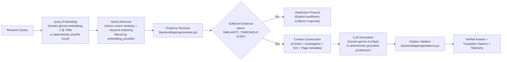

# RAG Pipeline Architecture

FlameSafe AI's Retrieval-Augmented Generation (RAG) subsystem (`backend/app/rag/`) enforces strict provenance, provider isolation, and abstention when empirical evidence is insufficient.

## Key Architectural Guarantees

1. **Provider Vector Isolation:** Embeddings store `embedding_provider` and `embedding_dimension` (`768`). Vector queries never mix `gemini` embeddings with deterministic `mock` embeddings (`test_mock_and_gemini_provider_vector_isolation`).
2. **Honest Telemetry:** `GET /api/v1/ai/status` executes a live probe when `GEMINI_API_KEY` is configured and reports `is_mock_provider: true` whenever the deterministic fallback is active.
3. **Citation Verification:** `citations.py` cross-checks cited DOIs and investigation acronyms against retrieved `EvidenceChunk` and `ResearchDocument` records.
