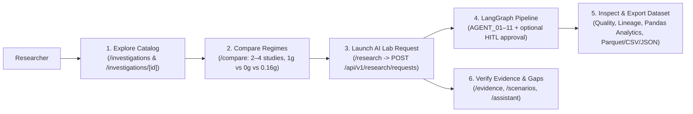

# End-to-End Research Workflow

This diagram illustrates the full researcher journey across FlameSafe AI—from exploring indexed NASA PSI campaigns to running the 11-agent LangGraph research pipeline and exporting validated datasets.

