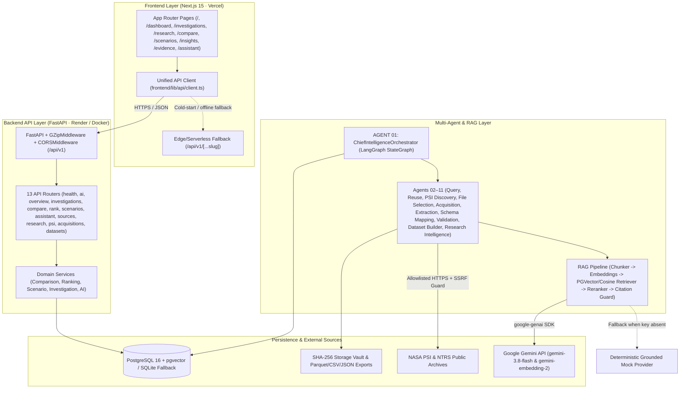

# System Architecture

FlameSafe AI uses a decoupled, contract-driven monorepo architecture separating the **Next.js 15 App Router** frontend from the **FastAPI + LangGraph** scientific backend.

## Layer Responsibilities

| Layer | Implementation Path | Verified Responsibility |
| :--- | :--- | :--- |
| **Frontend UI** | `frontend/app/`, `frontend/components/` | 10 interactive routes, Three.js 3D hero, Recharts visualizations, Astro-Flame companion |
| **API Client** | `frontend/lib/api/client.ts` | 60s GET caching, 4.5s cold-start timeout + background `/health` warmup, fallback to `/api/v1/[...slug]` |
| **API Gateway** | `backend/app/main.py`, `backend/app/api/v1/` | FastAPI v0.2.0, `GZipMiddleware`, `CORSMiddleware`, standardized `APIResponseEnvelope` |
| **Orchestration** | `backend/app/agents/orchestrator/supervisor.py` | LangGraph `StateGraph` coordinating Agents 02–11 with SQLAlchemy `AgentCheckpoint` persistence |
| **Scientific Data** | `backend/app/datasets/`, `backend/app/ingestion/` | SI unit normalization, deterministic bounds validation, SHA-256 vault, Parquet/CSV/JSON export |
| **RAG Engine** | `backend/app/rag/` | Bilingual chunking, 768-dim Gemini or deterministic mock embeddings, vector + keyword retrieval, citation verification |
