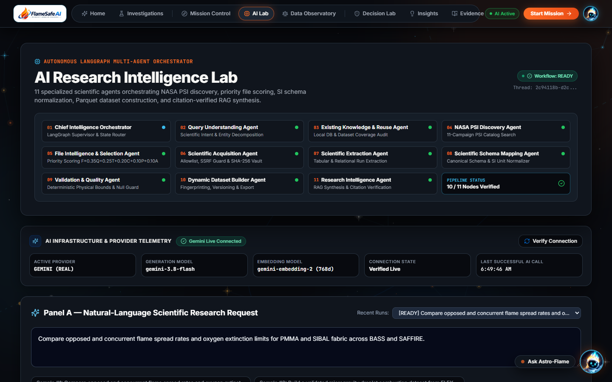

# AI Research Intelligence Lab (`/research`)

**Status:** `IMPLEMENTED AND TESTED`  
**Frontend Route:** `frontend/app/research/page.tsx`  
**Backend Endpoints:** `/api/v1/research/requests/*`, `/api/v1/psi/*`, `/api/v1/datasets/*`, `GET /api/v1/ai/status`

Orchestrates natural-language research requests through the 11-agent LangGraph `StateGraph` (`AGENT_01`–`AGENT_11`), surfaces live Gemini/mock provider telemetry, supports Human-in-the-Loop approval (`APPROVE`, `REJECT`, `MODIFY_PLAN`, `RESUME_WORKFLOW`), and provides the Dynamic Dataset Engine workspace (schema, quality report, lineage, diff, Pandas analytics, and Parquet/CSV/JSON export).

