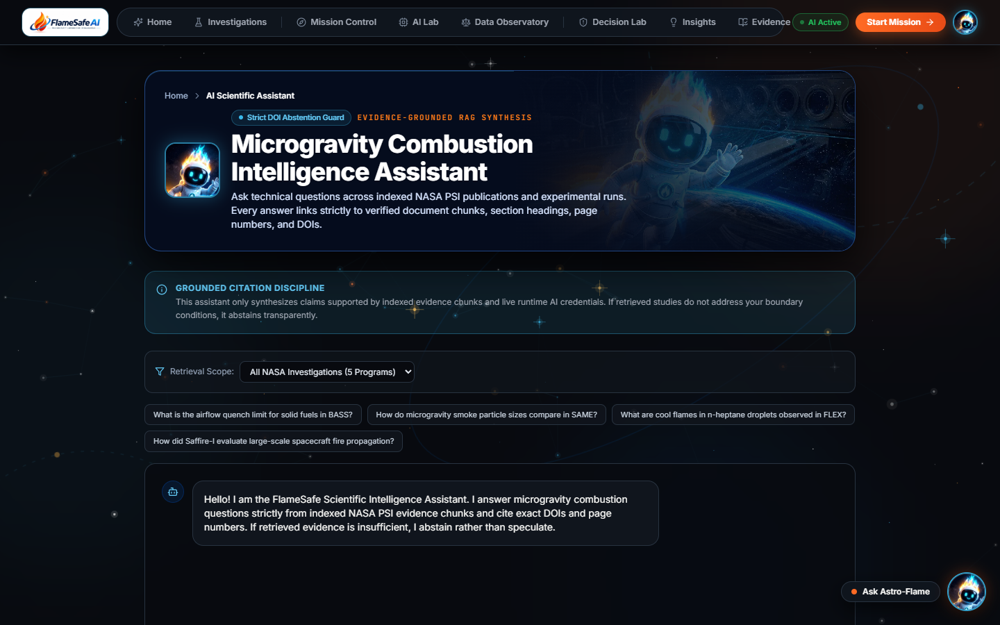

# Astro-Flame AI Research Companion (`/assistant` & Global Widget)

**Status:** `IMPLEMENTED AND TESTED`  
**Frontend:** `frontend/app/assistant/page.tsx`, `frontend/components/assistant/AstroFlameCompanion.tsx`  
**Backend Endpoint:** `POST /api/v1/assistant/query`

Provides citation-verified RAG answers grounded in retrieved `EvidenceChunk` records, surfacing DOI links and document page numbers while invoking an explicit abstention protocol when empirical evidence is insufficient.

