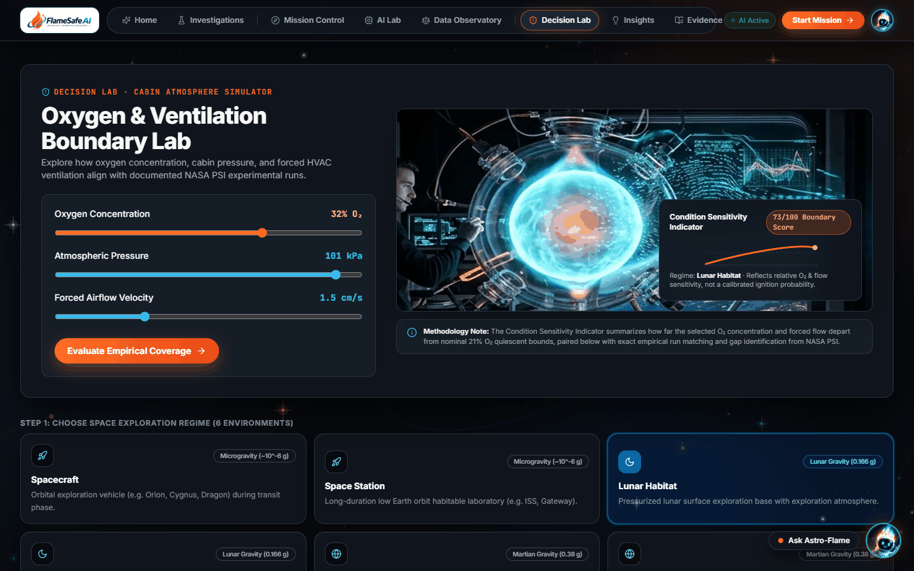

# Decision Lab & Research Gap Intelligence (`/scenarios`)

**Status:** `IMPLEMENTED AND TESTED`  
**Frontend Route:** `frontend/app/scenarios/page.tsx`  
**Backend Endpoint:** `POST /api/v1/scenarios/analyze`

Evaluates user-specified space habitat parameters (oxygen concentration, atmospheric pressure, forced airflow velocity, and target gravity environment) against empirical NASA PSI runs, classifying each condition as `Exact Match`, `Partial Match`, `Extrapolated Regime`, or `Unsupported Condition`, and highlighting identified research gaps.

> **Scientific Note:** The Condition Sensitivity Indicator reflects relative parameter departure from nominal 21% O2 quiescent bounds, not a calibrated ignition probability.

