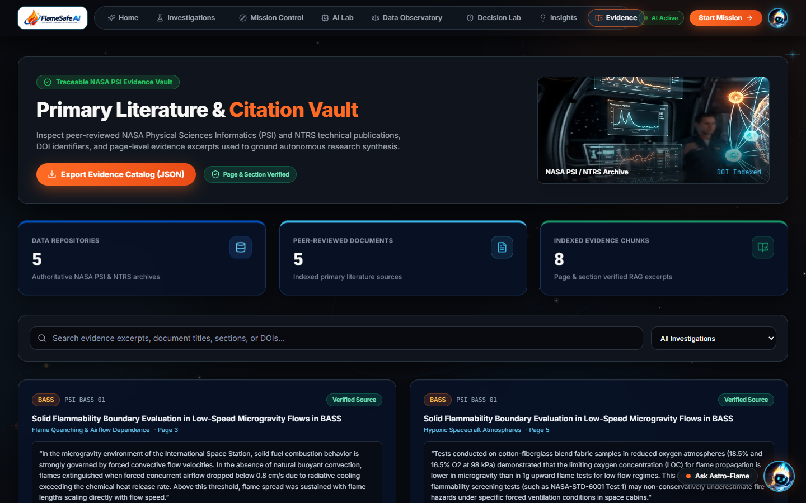

# Evidence & Citation Vault (`/evidence`)

**Status:** `IMPLEMENTED AND TESTED`  
**Frontend Route:** `frontend/app/evidence/page.tsx`  
**Backend Endpoints:** `GET /api/v1/sources`, `GET /api/v1/sources/{source_id}`

Provides a searchable vault of NASA PSI / NTRS primary literature, DOI identifiers, and page-level evidence excerpts, with one-click JSON catalog export.

