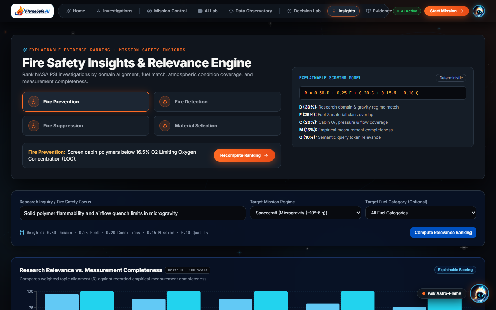

# Research Insights (`/insights`)

**Status:** `IMPLEMENTED AND TESTED`  
**Frontend Route:** `frontend/app/insights/page.tsx`  
**Backend Endpoint:** `POST /api/v1/rank` (`backend/app/ranking/scoring.py`)

Ranks indexed NASA PSI investigations by decision mode (`Fire Prevention`, `Fire Detection`, `Fire Suppression`, `Material Selection`) using the explainable `RelevanceScorer` weighted formula.

