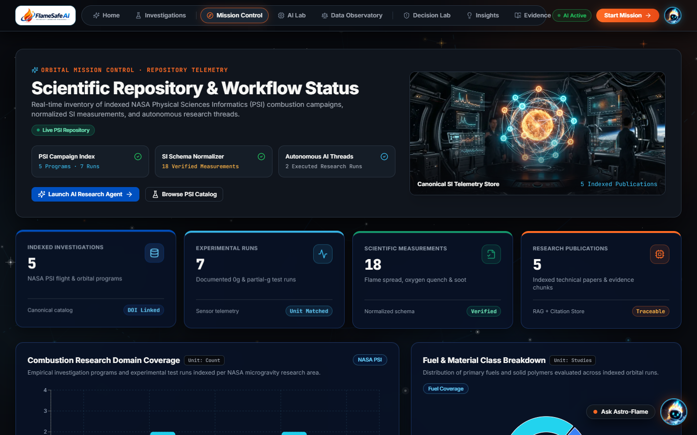

# Mission Control (`/dashboard`)

**Status:** `IMPLEMENTED AND TESTED`  
**Frontend Route:** `frontend/app/dashboard/page.tsx`  
**Backend Endpoints:** `GET /api/v1/overview`, `GET /api/v1/research/requests`

Mission Control provides repository-wide telemetry across indexed NASA PSI investigations, experimental runs, normalized SI measurements, and indexed publications, along with domain coverage and fuel-class breakdowns.

